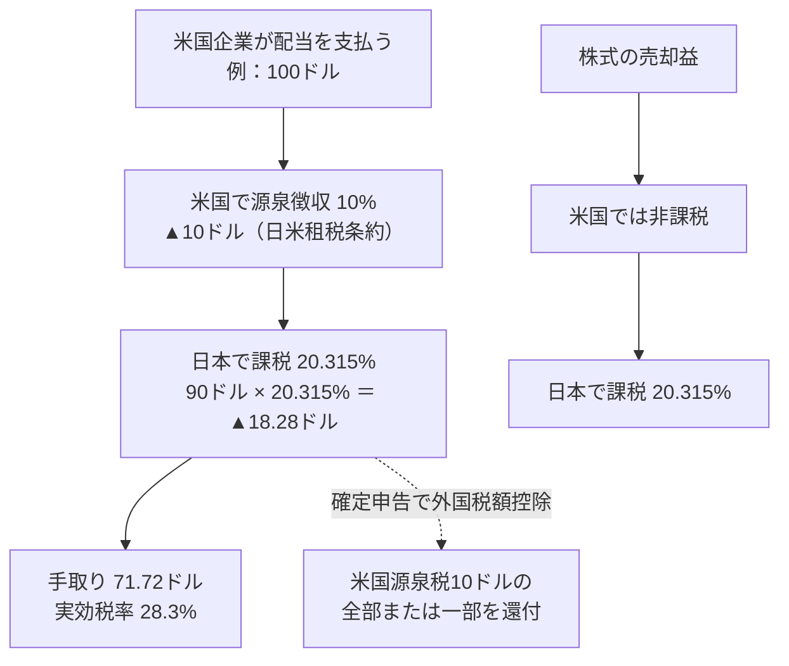

### 1-1 株式を保有するということ

株式を買うことは、その企業の**所有権の一部を取得する**ことである。企業が利益を上げれば、その利益は配当として株主に分配されるか、事業に再投資されて企業価値を高める。株価は、その所有権1単位に対して市場参加者が付ける値段であり、長期的には企業の利益と資本効率に収斂する（第3章）。

米国株の投資対象は、世界最大の消費市場を基盤とする企業群である。時価総額上位には、ソフトウェア、半導体、クラウド、決済、医薬、消費財の各分野で世界的なシェアを持つ企業が並ぶ。ピーター・リンチが説く「身近な製品・サービスから有望企業を見つける」というアプローチが機能しやすいのは、米国企業の製品が日本の生活にも深く浸透しているからである。

### 1-2 日本株との構造的な違い

| 項目 | 日本株 | 米国株 | 投資判断への意味 |
|---|---|---|---|
| 取引時間（日本時間） | 9:00〜11:30、12:30〜15:30 | 夏時間：22:30〜翌5:00 ／ 冬時間：23:30〜翌6:00 | 日中に注文を出し、夜間に約定する運用が基本（第13章） |
| 通貨 | 円 | 米ドル | 株価変動に為替変動が加わる |
| 売買単位 | 100株単位が原則 | **1株から** | 少額でも複数銘柄に分散できる |
| 値幅制限 | ストップ高・ストップ安あり | **なし** | 決算や事件で1日に30〜50%動くことがある |
| 配当頻度 | 年1〜2回 | **年4回（四半期）**が主流 | 再投資の機会が多い |
| 決算開示 | 四半期（決算短信） | 四半期（Form 10-Q）、年次（Form 10-K） | SECのEDGARで一次資料を読める（第11章） |
| 決算期 | 3月期が多い | 12月期が多いが企業により様々 | 1〜2月と7〜8月に決算が集中 |
| 株主優待 | あり | **なし** | 還元は配当と自社株買いのみ |
| 株式分割 | 比較的少ない | 頻繁（株価が高くなると実施） | 分割は企業価値を変えない |

{{chart:c01_trading_hours}}

夏時間（サマータイム）は3月第2日曜日に始まり11月第1日曜日に終わる。この期間は米国市場が日本時間22:30に開き、それ以外の期間は23:30に開く。決算発表は多くの場合、取引終了後（日本時間の早朝）または取引開始前に行われ、その日の寄付きで株価が大きく動く。

### 1-3 為替リスク — 株価と為替の二重の変動

米国株はドル建てで取引されるため、円で評価した資産額は「株価の変動 × 為替の変動」で決まる。

> **円換算評価額 ＝ 株価（ドル） × 株数 × 為替レート（円／ドル）**

{{chart:c02_fx_effect}}

| 株価の変動 | 為替の変動 | 円換算の損益 | 状況 |
|---|---|---:|---|
| ＋10% | 円安（156→170円） | ＋19.9% | 両方が追い風 |
| ＋10% | 円高（156→140円） | ▲1.3% | 株高を為替が相殺 |
| ▲10% | 円安（156→170円） | ▲1.9% | 株安を為替が相殺 |
| ▲10% | 円高（156→140円） | ▲19.2% | 両方が向かい風 |

長期の積立投資では、購入時期が分散されることで為替レートも平均化される。為替を予測して売買タイミングを計ることは、株価を予測することと同様に困難であり、**為替は「管理するリスク」であって「当てにいく対象」ではない**。円で生活する投資家にとって、ドル建て資産を持つこと自体が、円の購買力低下（円安・インフレ）に対する分散になる。

### 1-4 税金とNISA

米国株の配当と売却益には、以下の課税が行われる。

| 口座 | 配当への課税 | 売却益への課税 | 外国税額控除 | 損益通算 |
|---|---|---|---|---|
| 特定口座（源泉徴収あり） | 米国10% ＋ 日本20.315% | 日本20.315% | 確定申告で可能 | 可能 |
| NISA（成長投資枠） | 米国10%のみ（日本分は非課税） | **非課税** | 不可（日本で課税されていないため） | 不可 |

NISAでは日本の税がかからないため、売却益の非課税効果が大きい。米国の源泉徴収10%はNISAでも課されるが、それでも特定口座に比べて配当の手取りは約20ポイント改善する。**値上がり益と配当の両方を狙う長期保有銘柄・ETFはNISA成長投資枠を優先し、枠を超える分を特定口座で持つ**のが基本的な配分である。

### 1-5 投資対象の種類

| 種類 | 内容 | 分散 | コスト | 向いている用途 |
|---|---|---|---|---|
| 個別株 | 1社の株式 | なし（1社に集中） | 売買手数料のみ | 第II部の分析に基づく厳選投資 |
| ETF（上場投資信託） | 指数に連動する多数の株式の詰め合わせを、株式と同じように取引所で売買 | 高い（数百〜数千社） | 経費率（年率0.03%〜） | 資産形成のコア |
| 投資信託 | ETFと同様の分散商品だが、取引所ではなく基準価額で日次売買 | 高い | 信託報酬（ETFより高いことが多い） | 自動積立・少額積立 |
| ADR（米国預託証券） | 米国外企業（台湾、欧州、日本など）の株式を米国市場で取引可能にしたもの | なし | 売買手数料＋預託手数料 | 海外企業への投資 |
| REIT | 不動産に投資する法人の株式。利益の90%以上を配当 | 中 | 売買手数料のみ | インカム |

個別株は1社の業績に資産が連動するため、その企業の分析（第II部）が投資成果を左右する。ETFは1本で市場全体を保有でき、バートン・マルキールが『ウォール街のランダム・ウォーカー』で示した「市場平均を長期に上回り続けることは専門家にも困難である」という実証に基づく合理的な選択肢である。第15章の設計は、ETFをコアに置き、個別株をサテライトとして限定的に組み入れる構成を採る。

### 1-6 代表的なETF

| ティッカー | 連動指数 | 構成銘柄数 | 経費率（年率） | 分配金利回り（目安） | 性格 |
|---|---|---:|---:|---:|---|
| VOO | S&P 500 | 約500 | 0.03% | 約1.2% | 米国大型株の標準 |
| IVV／SPY | S&P 500 | 約500 | 0.03%／0.09% | 約1.2% | VOOと同内容（SPYは流動性最大） |
| VTI | CRSP米国総合市場 | 約3,500 | 0.03% | 約1.2% | 中小型株も含む全米 |
| QQQ | ナスダック100 | 100 | 0.18% | 約0.5% | 大型ハイテク集中 |
| VYM | FTSE高配当 | 約600 | 0.04% | 約2.2% | 高配当・広く分散 |
| SCHD | ダウ・ジョーンズ米国配当100 | 100 | 0.06% | 約2.9%〜 | 連続増配・品質フィルター |
| DIA | NYダウ | 30 | 0.16% | 約1.5% | 優良30社 |

数値は2026年半ばから9月上旬の公開情報に基づく目安であり、分配金利回りは市場価格により日々変動する（QQQの経費率0.18%はInvescoの2025年12月の公表に基づく）。経費率0.03%は、100万円の投資に対して年300円のコストであり、投資信託の一般的な信託報酬（0.1〜1.5%）と比べて極めて低い。第10章5節で示す通り、コストの差は複利で増幅されるため、**同じ指数に連動する商品の中では経費率の低いものを選ぶ**ことが原則である。

> **投資判断への直結**
> - 米国株は1株から買えるため、少額でも分散が可能。値幅制限がないため、決算日の値動きには注意する。
> - 円換算損益は「株価 × 為替」で決まる。為替は予測せず、積立で平均化する。
> - 長期保有銘柄・ETFはNISA成長投資枠を優先。配当の手取りは特定口座比で約20ポイント改善する。
> - 資産形成のコアは低コストのインデックスETF。個別株は第II部の分析に基づき限定的に組み入れる。
