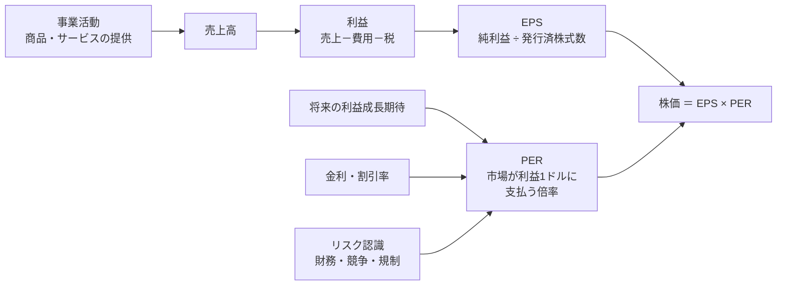
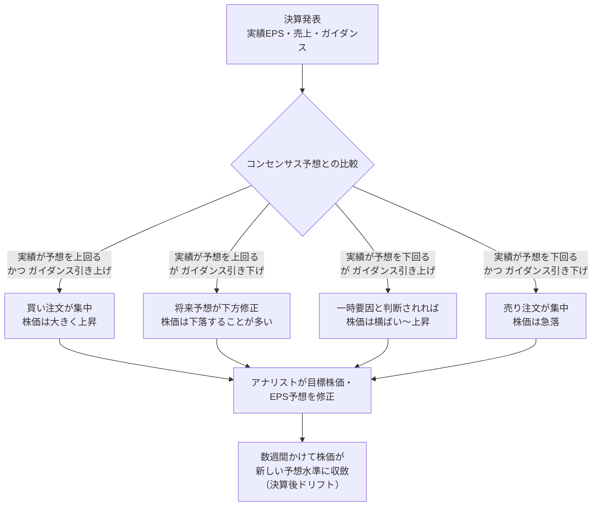
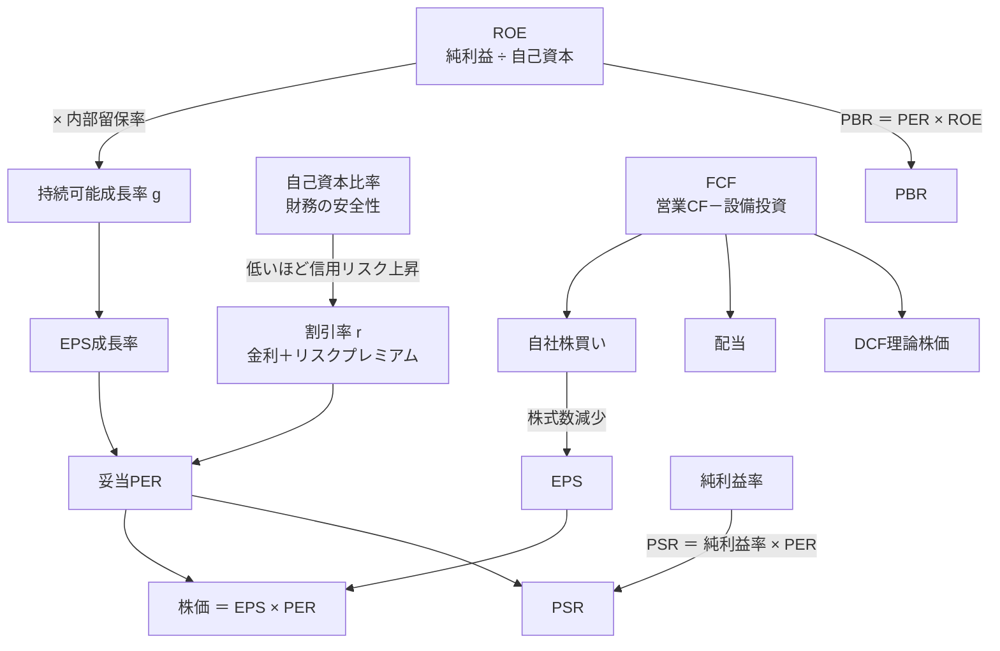

### 3-1 株価の分解式：株価 ＝ EPS × PER

あらゆる株価は、恒等式として次のように分解できる。

> **株価 ＝ EPS（1株当たり利益） × PER（株価収益率）**
> **時価総額 ＝ 純利益 × PER**

Apex Retailなら、EPS $8.00 × PER 15x ＝ $120.00 である。この式が重要なのは、株価変動の原因を**「業績（EPS）の変化」**と**「評価（PER）の変化」**という2つの独立した経路に切り分けられるからである。企業が何一つ変わらなくても、市場の期待や金利が変わればPERが動き、株価は動く。逆に、PERが不変でもEPSが成長すれば株価は同率で上昇する。

上図の左の経路（EPS）は主に**企業側の努力**で決まり、右の経路（PER）は主に**市場側の心理と金利環境**で決まる。長期投資家が制御可能なのは、「EPSが伸び続ける企業を、PERが妥当な水準にあるときに買う」ことだけである。

### 3-2 投資リターンの3つの源泉

株式の保有期間リターンは、次の3要素の合成で決まる。

> **総リターン ≒ EPS成長率 ＋ PERの変化率 ＋ 配当利回り**

Apex Retailを5年間保有した場合を、PERの変化別に試算する。EPSは年率10%で成長（$8.00 → $12.88）、配当は同率で増配（5年累計 $19.54）と仮定する。

| 5年後のPER | 5年後の株価 | 株価変化 | 累計配当 | 総リターン（5年） | 年率換算 |
|---:|---:|---:|---:|---:|---:|
| 12x（評価低下） | $154.6 | +28.8% | $19.5 | +45.1% | 7.7% |
| 15x（評価不変） | $193.3 | +61.1% | $19.5 | +77.3% | 12.1% |
| 18x（評価上昇） | $231.8 | +93.2% | $19.5 | +109.4% | 15.9% |

同じ企業、同じ業績でも、**PERが12xか18xかで年率リターンは2倍以上開く**。しかしEPS成長と配当だけで年率約12%が確保できている点にも注目してほしい。長期になるほどEPS成長と配当の寄与が支配的になり、PER変動の影響は相対的に薄まる。これが「良い企業を妥当な価格で長く持つ」戦略が機能する数学的根拠である。

### 3-3 短期の株価を動かすのは「期待との差」

決算発表で株価が動くのは、利益が増えたからではなく、**市場の事前予想（コンセンサス）と実績・ガイダンスの差**が生じたからである。市場は常に将来を織り込んでおり、「予想通りの好決算」は原則として株価を動かさない。

この構造から導かれる実務上の結論は2つある。第一に、**株価に織り込まれている期待水準を知らずに指標を見ても判断はできない**。第二に、市場が反応するのは「今期の数字」よりも「将来の予想が動いたか」であり、ガイダンスと経営陣のコメントが決算の核心である。

### 3-4 指標の相互関係マップ

第II部で扱う指標は独立ではなく、互いに数式で結ばれている。この関係を把握しておくと、1つの指標の変化が他の指標と株価にどう波及するかを追跡できる。

| 指標 | 計算式 | 測るもの | 主な用途 | 解説章 |
|---|---|---|---|---|
| EPS | 純利益 ÷ 発行済株式数 | 1株が生む利益 | 業績の基本単位 | 第4章 |
| PER | 株価 ÷ EPS | 利益に対する評価倍率 | 割安・割高判断（黒字企業） | 第5章 |
| PEG | PER ÷ EPS成長率 | 成長を加味した割安度 | グロース株の評価 | 第5章 |
| ROE | 純利益 ÷ 自己資本 | 株主資本の運用効率 | 企業の質・複利力 | 第6章 |
| PBR | 株価 ÷ 1株当たり純資産 | 純資産に対する評価倍率 | 資産価値との比較 | 第6章 |
| ROIC | 税引後営業利益 ÷ 投下資本 | 事業全体の資本効率 | 競争優位（モート）の検証 | 第6章 |
| PSR | 時価総額 ÷ 売上高 | 売上に対する評価倍率 | 赤字・高成長企業の評価 | 第7章 |
| FCF | 営業CF － 設備投資 | 自由に使える現金 | 還元余力・理論株価の基礎 | 第8章 |
| FCF利回り | FCF ÷ 時価総額 | 株価に対する現金創出力 | 債券利回りとの比較 | 第8章 |
| 自己資本比率 | 自己資本 ÷ 総資産 | 財務の安全性 | 倒産・希薄化リスク | 第9章 |
| 純有利子負債/EBITDA | （有利子負債－現金）÷ EBITDA | 借金の返済年数 | 信用リスク | 第9章 |

### 3-5 第II部が準拠する世界標準の投資理論

第II部の分析枠組みは、英語圏の主要金融メディア（Investopedia、Morningstar、Seeking Alpha、The Motley Fool等）が共通して前提とする、以下の理論体系に基づいている。

| 理論・概念 | 提唱者・出典 | 本書での位置づけ |
|---|---|---|
| 割引キャッシュフロー（DCF）による内在価値 | John Burr Williams（1938）、Morningstarのフェアバリュー推計 | 第8章の理論株価算出の骨格 |
| 安全域（Margin of Safety） | Benjamin Graham『賢明なる投資家』 | 理論株価と市場価格の差を買う根拠 |
| オーナー利益・ROE重視・モート | Warren Buffett（バークシャー株主への手紙） | 第6章・第8章の質の評価 |
| ROIC > WACC による価値創造、エコノミック・モート | Morningstar Equity Research の評価体系 | 第6章のROIC分析 |
| PEGレシオ、企業の6分類 | Peter Lynch『ピーター・リンチの株で勝つ』 | 第5章のグロース株評価 |
| 成長企業の質的分析（15のポイント） | Philip Fisher『超成長株投資の法則』 | 第11章のグロース判断チェック |
| 期待投資（株価から市場の期待を逆算する） | Alfred Rappaport・Michael Mauboussin『Expectations Investing』 | 第7章・第8章の逆算分析 |
| デュポン分析（ROEの3分解） | DuPont社（1920年代）、Investopedia標準解説 | 第6章 |
| Rule of 40 | SaaS投資家コミュニティ（Brad Feld 等） | 第7章の高成長企業評価 |
| 効率的市場仮説と長期分散投資 | Eugene Fama、Burton Malkiel『ウォール街のランダム・ウォーカー』 | 第10章の長期リターン論の前提 |
