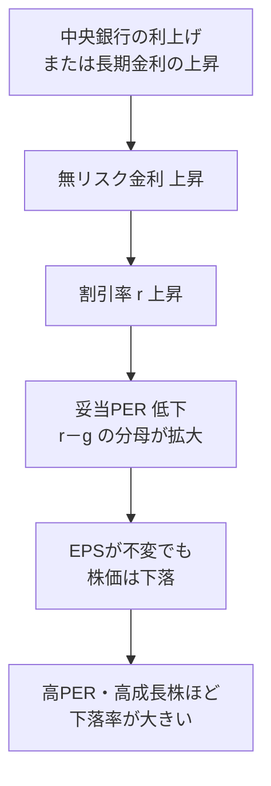

### 5-1 定義と計算式

> **PER ＝ 株価 ÷ EPS ＝ 時価総額 ÷ 純利益**
> **益回り（Earnings Yield） ＝ EPS ÷ 株価 ＝ 1 ÷ PER**

PERは「現在の利益水準が続くと仮定したとき、株価を回収するのに何年かかるか」を表す。益回りはその逆数で、「株価に対して利益が年何%生まれているか」を示し、債券利回りと直接比較できる。

| 企業 | 株価 | EPS（実績） | PER（実績） | EPS（翌年予想） | PER（予想） | 益回り |
|---|---:|---:|---:|---:|---:|---:|
| Apex Retail | $120 | $8.00 | **15.0x** | $8.80 | 13.6x | 6.67% |
| Nova Cloud | $200 | ▲$1.00 | **算出不能** | ▲$0.50 | 算出不能 | ― |
| Ironclad Power | $30 | $2.75 | **10.9x** | $2.83 | 10.6x | 9.17% |

実績PER（Trailing）は確定した数字に基づく安全な指標だが、市場が実際に評価しているのは**予想PER（Forward）**である。両者の差が大きい企業ほど、市場は大きなEPS成長を織り込んでいる。

### 5-2 PERが意味するもの — 益回りと債券利回りの比較

益回りを国債利回りと比べると、「株式というリスクを取る対価として、市場がどれだけの上乗せを要求しているか」が見える。

| 比較対象（例） | 利回り | Apex Retail益回りとの差 |
|---|---:|---:|
| 米10年国債利回り（仮定） | 4.50% | ― |
| Apex Retail 益回り | 6.67% | ＋2.17ポイント |
| Ironclad Power 益回り | 9.17% | ＋4.67ポイント |

Apex Retailの益回り6.67%は、国債より2.17ポイント高い。この上乗せ分が**株式リスクプレミアム**の実現値である。Ironclad Powerの上乗せは4.67ポイントとさらに大きいが、これは「安い」のではなく、市場が低成長と財務リスク（第9章）に対して高い対価を要求している結果である。**益回りが高い＝割安、ではなく、益回りが高い＝市場が高いリスクか低い成長を見込んでいる**、と読むのが正しい。

なお、実際の米10年国債利回りは2026年10月16日に約5.10%まで上昇している（第14章2節）。この水準を当てはめると、Apex Retailの上乗せは1.57ポイントに縮む。金利が上がるほど、同じ益回りの株式は相対的に魅力が薄れる。

### 5-3 PERを決定する3つの変数

理論上、安定配当企業の妥当PERは次の式で近似できる（ゴードン成長モデルから導出）。

> **妥当PER（予想ベース） ＝ 配当性向 ÷ （r － g）**
> r ＝ 株主資本コスト（割引率）＝ 無リスク金利 ＋ 株式リスクプレミアム
> g ＝ 利益の永続成長率

配当性向50%の企業について、rとgの組み合わせで妥当PERがどう変わるかを示す。

| 割引率 r ＼ 成長率 g | g ＝ 2% | g ＝ 4% | g ＝ 6% |
|---:|---:|---:|---:|
| **8%** | 8.3x | 12.5x | 25.0x |
| **9%** | 7.1x | 10.0x | 16.7x |
| **10%** | 6.3x | 8.3x | 12.5x |
| **11%** | 5.6x | 7.1x | 10.0x |

{{chart:c07_per_sensitivity}}

表から3つの構造が読み取れる。

1. **成長率gが高いほどPERは高い**。g＝4%からg＝6%へ2ポイント上がるだけで、PERは1.5〜2倍になる。高成長株に高いPERが付くのは合理的である。
2. **割引率rが上がるとPERは下がる**。rは金利に連動するため、**利上げ局面ではEPSが変わらなくてもPERが圧縮され株価が下がる**。
3. **rとgの差が小さいほどPERは金利変動に敏感になる**。g＝6%の列は、rが8%から11%に上がるとPERが25xから10xへ60%も下落する。高PERの成長株ほど金利上昇に脆弱である理由がここにある。

{{chart:c25_rate_per_chain}}

Apex Retailで数値化する。EPS $8.00、妥当PER 15xで株価$120のとき、金利上昇で妥当PERが13xに低下すると、株価は $8.00 × 13 ＝ **$104（▲13.3%）**となる。企業の業績には何の変化もない。2022年の米国市場で高PERのテクノロジー株が大きく下落した現象は、この機構で説明できる。

### 5-4 PEGレシオ — 成長率で割ってPERを正規化する

PERは成長率が異なる企業間では比較できない。ピーター・リンチが普及させたPEGレシオは、PERを成長率で割ることで比較可能にする。

> **PEG ＝ PER ÷ EPS成長率（%）**
> 目安：1.0を下回れば成長に対して割安、2.0を超えれば割高（リンチの経験則）

| 企業（例） | PER | EPS成長率（年率） | PEG | 解釈 |
|---|---:|---:|---:|---|
| Apex Retail | 15.0x | 10% | **1.50** | 妥当〜やや割高 |
| Ironclad Power | 10.9x | 3% | **3.64** | PERは低いが成長に対しては割高 |
| 架空Growth Co. | 40.0x | 35% | **1.14** | PERは高いが成長に対しては妥当 |
| 架空Slow Co. | 12.0x | 4% | **3.00** | 低PERの見た目に反して割高 |

Ironclad Powerは3社中最も低いPERだが、PEGでは最も割高である。**低PERは「安い」ではなく「成長が期待されていない」を意味することが多い**。PEGはこの錯覚を排除する。

PEGの使用上の注意は次の通りである。

- 成長率には「今後3〜5年の持続可能な年率」を使う。直近1年の一時的な高成長でPEGを計算すると、割安に見えすぎる。
- 成長率が10%未満の企業や、景気循環株にはPEGは適さない。
- 配当利回りが高い企業は、成長率に配当利回りを加えた「配当調整PEG（PER ÷（成長率＋配当利回り））」で見ると公平になる。Ironclad Powerは 10.9 ÷（3＋6.67）＝ 1.13 となり、インカム株としては妥当な水準に見える。

### 5-5 相対比較 — 業種・自社の履歴・市場全体

PERの絶対水準に普遍的な「適正値」は存在しない。判断は必ず相対比較で行う。

| 比較軸 | 方法 | Apex Retailでの例 |
|---|---|---|
| 業種内比較 | 同業他社の予想PER中央値と比較 | 小売業種の予想PER中央値が17xなら、13.6xは相対的に割安 |
| 自社の履歴比較 | 過去5〜10年のPERレンジ（最高・最低・中央値）と比較 | 過去10年のレンジが12〜22x、中央値16xなら、現在15xは中央値付近 |
| 市場全体との比較 | S&P 500の予想PERと比較 | 市場が20xなら、15xは市場より低い評価 |
| 金利環境との比較 | 益回り－10年国債利回り（リスクプレミアム）の履歴 | 過去平均が3ポイントなら、現在の2.17ポイントはやや割高方向 |

業種によるPERの典型的レンジは、資本集約度・成長率・利益の安定性で決まる（以下は金利環境で変動する概ねの目安）。

| 業種 | 予想PERの概ねのレンジ | 高低の理由 |
|---|---:|---|
| ソフトウェア・クラウド | 25〜40x | 高成長・高粗利・低資本集約 |
| 半導体 | 20〜35x | 高成長だが景気循環性あり |
| 生活必需品 | 18〜25x | 低成長だが利益が極めて安定 |
| ヘルスケア | 15〜25x | 安定需要、規制リスク |
| 小売 | 12〜25x | 業態による差が大きい |
| 公益 | 14〜19x | 低成長・規制収益・高配当 |
| 銀行 | 9〜13x | 高レバレッジ・景気敏感 |
| エネルギー | 8〜14x | 商品価格依存で利益変動が激しい |

市場全体の長期的な割高・割安を測る指標として、10年平均の実質EPSで計算する**CAPE（シラーPER）**も広く使われる。CAPEが歴史的高水準にあるときは、市場全体のPER圧縮リスクが高まっている状態である。

### 5-6 低PERの罠と高PERの正当化

**低PERの罠（バリュートラップ）**：PERが低い企業の多くは、市場が正しく「利益の減少」を予見している。EPSが年率10%で減る企業のPERは、EPS減少に伴って上昇し続け、株価は下がり続ける。特に景気循環株（鉄鋼、化学、自動車、半導体製造装置）は、**利益がピークにあるときPERが最も低く見え、利益が底にあるときPERが最も高く見える**。リンチはこれを「景気循環株は低PERで売り、高PERで買う」という逆説として整理した。

| 景気循環株の局面 | EPS | PER | 株価 | 正しい行動 |
|---|---:|---:|---:|---|
| 好況ピーク | $10.00（最高） | 8x | $80 | 低PERに惑わされず売却を検討 |
| 景気後退期 | $2.00（最低） | 30x | $60 | 高PERに見えるが底値圏 |

**高PERの正当化**：PER 40xが妥当となる条件は、(1) 高いEPS成長率が長期間持続する、(2) ROICが高く成長に追加資本をほとんど要しない、(3) 利益の予見性が高い、の3つである。この3条件を満たす企業（強固なモートを持つソフトウェア・プラットフォーム企業など）は、高PERでも長期リターンが市場平均を上回ることがある。ただし、第7章で示す通り、**高PER・高PSRは「成長が減速した瞬間にPERとEPS予想が同時に切り下がる二重の下落」を内包する**。

> **投資判断への直結**
> - PERは単独では意味を持たない。同業種・自社履歴・市場全体・金利環境の4軸で相対評価する。
> - 金利上昇局面では、EPSが健全でもPER圧縮で株価が下がる。高PER株ほど影響が大きい。
> - 成長率で正規化したPEGを併用し、「低PER＝割安」「高PER＝割高」の錯覚を排除する。
> - 景気循環株は利益ピークで低PER、利益ボトムで高PERに見える。業種特性を確認してから判断する。
