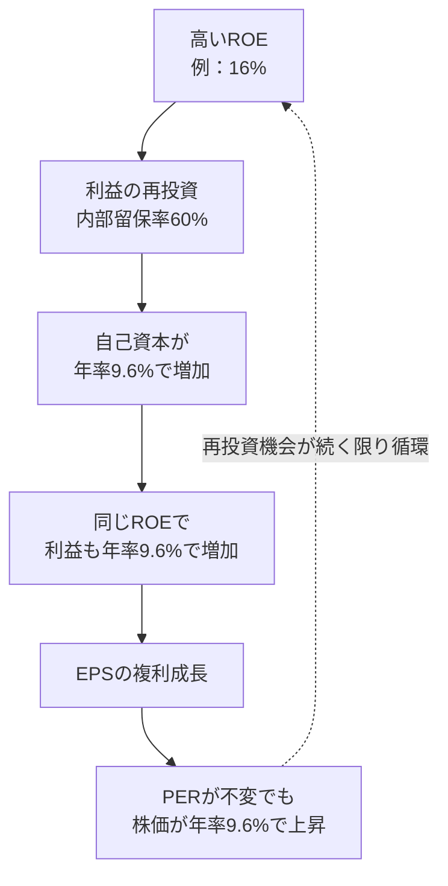

### 6-1 ROEの定義と計算式

> **ROE（自己資本利益率） ＝ 純利益 ÷ 自己資本（期首・期末平均が望ましい）**

ROEは「株主が預けた資本1ドルが、1年間で何セントの利益を生んだか」を示す。株主にとっての企業の「利回り」であり、長期的な複利成長の源泉である。

| 企業 | 純利益 | 自己資本 | ROE |
|---|---:|---:|---:|
| Apex Retail | 8.0億ドル | 50.0億ドル | **16.0%** |
| Nova Cloud | ▲1.0億ドル | 30.0億ドル | **▲3.3%** |
| Ironclad Power | 5.5億ドル | 40.0億ドル | **13.75%** |

ROE 16%の企業は、利益を再投資し続ければ自己資本が理論上年率16%で増える。米国の優良企業は長期にわたりROE 15〜20%以上を維持しており、S&P 500構成企業の平均はおおむね15%前後で推移してきた。

### 6-2 デュポン分解 — ROEの「中身」を3つに分ける

同じROEでも、その源泉が「本業の収益性」か「借入」かで意味はまったく異なる。デュポン分析はROEを3要素に分解する。

> **ROE ＝ 純利益率 × 総資産回転率 × 財務レバレッジ**
> ＝ （純利益 ÷ 売上高） × （売上高 ÷ 総資産） × （総資産 ÷ 自己資本）

| 企業 | 純利益率 | × 総資産回転率 | × 財務レバレッジ | ＝ ROE | ROEの主な源泉 |
|---|---:|---:|---:|---:|---|
| Apex Retail | 8.0% | 1.00 | 2.00 | **16.0%** | 収益性と資産効率のバランス |
| Nova Cloud | ▲5.0% | 0.50 | 1.33 | **▲3.3%** | 現時点では赤字 |
| Ironclad Power | 11.0% | 0.33 | 3.75 | **13.75%** | **財務レバレッジ（借入）** |

{{chart:c08_dupont}}

Ironclad Powerの純利益率はApexより高いが、資産回転率が低く（発電設備が重い）、ROEの大半は財務レバレッジ3.75倍、つまり総資産の73%を負債で賄っていることによって生み出されている。**借入で膨らませたROEは、金利上昇や利益減少で急速に崩れる**（第9章のストレステスト）。一方、Apex Retailのレバレッジ2.0倍は小売業として標準的であり、ROE 16%は本業の収益性に裏付けられている。

| デュポン要素 | 改善させる経営行動 | 投資家が確認すべき点 |
|---|---|---|
| 純利益率 | 価格決定力、コスト削減、ミックス改善 | 粗利率・営業利益率の推移（モートの証拠） |
| 総資産回転率 | 在庫効率、資産の軽量化、店舗生産性 | 同業比較、資産の肥大化の有無 |
| 財務レバレッジ | 借入増、自社株買いによる自己資本減 | 自己資本比率・利払い能力（第9章） |

### 6-3 ROEと持続可能成長率 — 複利マシンの原理

企業が外部資金に頼らず持続できる利益成長率は、ROEと内部留保率で決まる。

> **持続可能成長率 g ＝ ROE × （1 － 配当性向）**

| 企業 | ROE | 配当性向 | 内部留保率 | 持続可能成長率 g |
|---|---:|---:|---:|---:|
| Apex Retail | 16.0% | 40%（$3.20 ÷ $8.00） | 60% | **9.6%** |
| Ironclad Power | 13.75% | 72.7%（$2.00 ÷ $2.75） | 27.3% | **3.75%** |

Apex Retailの市場コンセンサスであるEPS成長率10%は、持続可能成長率9.6%とほぼ整合しており、外部借入や増資なしで達成可能な現実的な予想と評価できる。Ironclad Powerは利益の73%を配当に回すため、再投資に回る資本が少なく、成長率3%台が構造的な上限となる。

この循環が長期投資の核心である。バフェットが「ROEが高く、その利益を高いROEで再投資し続けられる企業」を最重視する理由は、この複利マシンが株主の資本を自動的に増やし続けるからである。逆に、高ROEでも再投資先がなく利益を全額配当する企業は、成長を株主自身の再投資判断に委ねることになる。

### 6-4 PBRとROEの関係 — なぜ純資産の2.4倍の値段が付くのか

> **PBR（株価純資産倍率） ＝ 株価 ÷ 1株当たり純資産（BPS）＝ 時価総額 ÷ 自己資本**
> **恒等式：PBR ＝ PER × ROE**

| 企業 | 自己資本 | BPS | 株価 | PBR | 検算（PER × ROE） |
|---|---:|---:|---:|---:|---:|
| Apex Retail | 50.0億 | $50.00 | $120 | **2.40x** | 15.0 × 0.160 ＝ 2.40 |
| Nova Cloud | 30.0億 | $30.00 | $200 | **6.67x** | ―（赤字） |
| Ironclad Power | 40.0億 | $20.00 | $30 | **1.50x** | 10.9 × 0.1375 ＝ 1.50 |

PBRが高いことは、それ自体では割高を意味しない。**PBRはROEの関数**であり、市場はROEが高い企業の純資産に高い倍率を付ける。PERを15xに固定してROE別の妥当PBRを示す。

| ROE | 妥当PBR（PER 15x） | 意味 |
|---:|---:|---|
| 8% | 1.2x | 純資産をわずかに上回る評価 |
| 16% | 2.4x | Apex Retailの現在水準 |
| 24% | 3.6x | 優良企業の典型的水準 |
| 40% | 6.0x | 資本をほとんど使わない高収益企業 |

PBRが1倍を割る企業は「解散価値以下」と言われるが、実際には市場が「ROEが資本コストを下回り続ける＝資本を毀損している」と判断している場合がほとんどである。PBR 1倍割れは、ROEの回復（業績改善・自社株買い・資産売却）が見込めるときにのみ投資機会となる。

### 6-5 ROICと資本コスト — 価値を「創造」しているか「破壊」しているか

ROEは株主資本だけを分母にするため、借入の影響を受ける。事業そのものの資本効率を測るには、負債と自己資本を合算した投下資本に対するリターン、ROICを使う。

> **ROIC ＝ 税引後営業利益（NOPAT） ÷ 投下資本**
> NOPAT ＝ 営業利益 × （1 － 税率）
> 投下資本 ＝ 有利子負債 ＋ 自己資本 － 余剰現金

| 企業 | 営業利益 | 税率 | NOPAT | 投下資本 | ROIC | WACC（仮定） | スプレッド |
|---|---:|---:|---:|---:|---:|---:|---:|
| Apex Retail | 11.0 | 20% | 8.8 | 20＋50－10 ＝ 60.0 | **14.7%** | 9.0% | **＋5.7pt** |
| Ironclad Power | 10.0 | 21.4% | 7.86 | 80＋40－3 ＝ 117.0 | **6.7%** | 7.0% | **▲0.3pt** |

Morningstarのエコノミック・モート評価の中核はこの比較にある。**ROICがWACC（加重平均資本コスト）を上回る企業は、事業に投じた1ドルが1ドル以上の価値を生んでいる**。Apex RetailはWACCを5.7ポイント上回り、成長のための再投資が株主価値を増やす。Ironclad PowerはROICがWACCとほぼ同水準であり、規制事業として安定しているものの、成長投資が株主価値を増やす構造にはない。市場がIronclad PowerにPER 10.9x、PBR 1.5xという低い評価しか与えない理由は、ROEの高さではなく、ROICのこの低さにある。

### 6-6 なぜROEで株価が動くのか

| ROEの変化 | 市場の解釈 | PBR・PERへの影響 | 株価への経路 |
|---|---|---|---|
| ROE上昇（純利益率改善による） | 価格決定力・モートの強化 | PBR上昇（プレミアム拡大） | EPS増加 × PER上昇の二重効果 |
| ROE上昇（レバレッジ増による） | リスク増大、質の低い改善 | PBRは限定的上昇、割引率上昇 | EPS増加をPER低下が相殺 |
| ROE上昇（自社株買いで自己資本減） | 資本配分次第で評価が分かれる | 買付価格が理論株価以下なら肯定的 | EPS増加、ただし財務悪化に注意 |
| ROE低下（競争激化で利益率悪化） | モートの侵食 | PBR・PER両方が低下 | 二重の下落（デレーティング） |

**ROEの低下は、EPSの減少とPERの低下を同時に引き起こす**。市場はROEの水準そのものよりも、ROEの「持続性」と「方向」を評価しており、高ROEが数年続けて低下し始めた企業は、EPSがまだ成長していても株価が下落することがある。

### 6-7 ROEの落とし穴

| 落とし穴 | 何が起きているか | 見抜き方 |
|---|---|---|
| 自己資本の異常な縮小 | 大規模な自社株買いで自己資本が極端に小さくなり、ROEが50%や100%、あるいはマイナス（債務超過）になる | ROEではなくROICで評価する。自己資本比率と併せて見る |
| 一時的利益の混入 | 資産売却益で純利益が膨らみ、ROEが一時的に跳ねる | 経常的な営業利益ベースで再計算する |
| のれんの減損後 | 減損で自己資本が減り、ROEが見かけ上改善する | 減損前後の推移を確認する |
| 高レバレッジ | 財務レバレッジ3倍超でROEを維持している | デュポン分解で源泉を特定し、第9章の利払い能力を確認する |

> **投資判断への直結**
> - ROE 15%以上を5年以上維持し、その源泉が純利益率（本業）にある企業を長期保有の第一候補とする。
> - 持続可能成長率（ROE × 内部留保率）とアナリストのEPS成長予想を照合し、予想の現実性を検証する。
> - PBRはROEと組で見る。高PBRは高ROEの結果であり、低PBRは資本毀損の結果であることが多い。
> - ROIC > WACC を確認する。この条件を満たさない企業は、成長しても株主価値を生まない。
