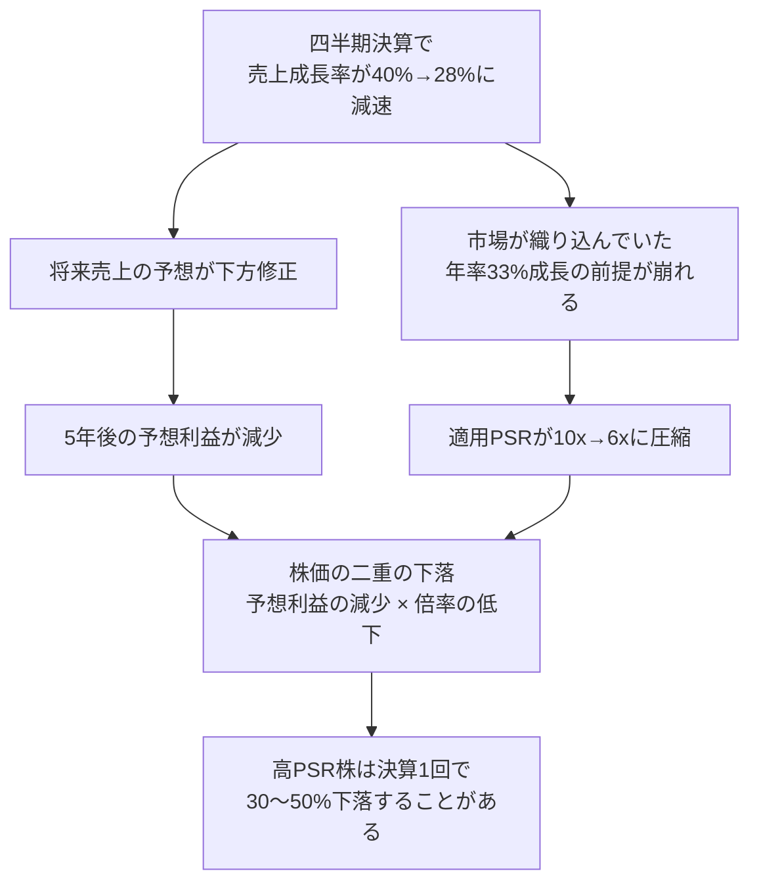

### 7-1 定義と計算式

> **PSR（Price to Sales Ratio） ＝ 時価総額 ÷ 売上高 ＝ 株価 ÷ 1株当たり売上高**
> **EV/Sales ＝ 企業価値（時価総額 ＋ 純有利子負債） ÷ 売上高**

| 企業 | 時価総額 | 売上高 | PSR | EV | EV/Sales |
|---|---:|---:|---:|---:|---:|
| Apex Retail | 120億 | 100億 | **1.2x** | 130億 | 1.3x |
| Nova Cloud | 200億 | 20億 | **10.0x** | 175億 | 8.75x |
| Ironclad Power | 60億 | 50億 | **1.2x** | 137億 | 2.7x |

Nova Cloudのように純利益が赤字の企業ではPERが計算できない。売上高は利益より操作されにくく、赤字でも必ず存在するため、高成長企業の評価にはPSR（機関投資家は主にEV/Sales）が使われる。ネットキャッシュを持つNova CloudのEV/Salesは8.75xとPSRより低く、負債の重いIronclad PowerのEV/Salesは2.7xとPSRより高い。**負債構造が異なる企業を比較するときは、EVベースを用いる**。

### 7-2 PSRの正体 — PSR ＝ 純利益率 × PER

PSRは独立した指標ではなく、次の恒等式で他の指標と結ばれている。

> **PSR ＝ 純利益率 × PER**
> Apex Retail：8% × 15.0 ＝ 1.2x ／ Ironclad Power：11% × 10.9 ＝ 1.2x

この式は、PSRの意味を決定的に明らかにする。**PSR 10xという評価は、「将来のある時点で企業が達成する純利益率」と「そのときのPER」の積が10になることを市場が前提にしている**ということである。

| 将来の純利益率（成熟時） | PSR 10xが含意する将来PER | 現実性の評価 |
|---:|---:|---|
| 10% | 100x | 極めて非現実的 |
| 20% | 50x | 高成長が長期継続しない限り困難 |
| 25% | 40x | 優良ソフトウェア企業の典型的水準 |
| 33% | 30x | 最高水準の利益率とPERが両立して初めて成立 |

Nova CloudのPSR 10xは、「将来25%程度の純利益率を達成し、その時点でも40x程度のPERで評価される」というシナリオを織り込んでいる。この前提が崩れれば、株価は大きく調整される。

### 7-3 シナリオ分析 — 現在の株価で買った投資家は何年後にいくらになるか

Nova Cloudを$200で買い、5年間保有した場合の株価を3シナリオで試算する。株式報酬による希薄化を年5%（5年で株式数1.00億 → 1.276億株）と仮定する。

| 項目 | ブル（強気） | ベース（標準） | ベア（弱気） |
|---|---:|---:|---:|
| 売上成長率（5年CAGR） | 40% | 25% | 15% |
| 5年後の売上高 | 107.5億 | 61.0億 | 40.2億 |
| 5年後の純利益率 | 20% | 15% | 10% |
| 5年後の純利益 | 21.5億 | 9.2億 | 4.0億 |
| 5年後のPER | 30x | 25x | 20x |
| 5年後の時価総額 | 645億 | 229億 | 80億 |
| 5年後の株式数 | 1.276億株 | 1.276億株 | 1.276億株 |
| **5年後の株価** | **$506** | **$179** | **$63** |
| 5年間の年率リターン | **＋20.4%** | **▲2.2%** | **▲20.6%** |

{{chart:c09_nova_scenarios}}

この表が示す事実は重い。**年率25%の売上成長を5年間続け、利益率15%を達成しても、$200で買った投資家はリターンを得られない**。売上成長率25%は多くの企業にとって優れた実績だが、PSR 10xが織り込む期待には届かない。

逆算すると、$200の株価から年率10%のリターンを得るためには、5年後に株価$322、時価総額411億ドルが必要である。PER 25x、純利益率20%を仮定すると、必要売上高は82億ドル、**5年間の売上CAGRは32.7%**となる。これが「現在の株価に織り込まれた期待」であり、Rappaport・Mauboussinの期待投資の考え方はこの逆算を出発点とする。投資判断は「この企業は年率33%成長を5年続けられるか」という具体的な問いに帰着する。

### 7-4 PSRを補正する — 粗利率とRule of 40

**粗利率による補正**：PSRは業種間で比較できない。粗利率35%の小売業と粗利率75%のソフトウェア企業では、同じ売上1ドルが将来生む利益の上限が異なる。時価総額を粗利益で割ると、この差を調整できる。

| 企業 | 時価総額 | 売上総利益 | 時価総額 ÷ 粗利益 |
|---|---:|---:|---:|
| Apex Retail | 120億 | 35.0億 | 3.4x |
| Nova Cloud | 200億 | 15.0億 | 13.3x |
| Ironclad Power | 60億 | 25.0億 | 2.4x |

PSRでは8.3倍（10.0 ÷ 1.2）だったNovaとApexの差は、粗利ベースでは3.9倍（13.3 ÷ 3.4）に縮む。それでもNovaが大幅に高い評価であることに変わりはない。

**Rule of 40**：SaaS・クラウド企業の評価で標準的に用いられる経験則で、「売上成長率 ＋ 利益率（FCFマージンまたは営業利益率）≧ 40%」なら、成長と収益性のバランスが健全と判断する。

| Nova Cloud | 売上成長率 | ＋ 利益率 | ＝ スコア | 判定 |
|---|---:|---:|---:|---|
| FCFマージンで計算 | 40% | ＋2.5% | 42.5 | 合格 |
| 営業利益率で計算 | 40% | ▲10.0% | 30.0 | 不合格 |
| SBC控除後FCFマージンで計算 | 40% | ▲12.5% | 27.5 | 不合格 |

同じ企業でも利益率の定義によって判定が変わる。**Nova CloudのFCFマージン2.5%は、株式報酬3.0億ドルを非現金費用として足し戻した結果であり、株主の希薄化という形で確実にコストを負担している**。厳格な投資家はSBC控除後の数値で判定する（第8章4節）。

### 7-5 なぜPSRの変化が株価を激しく動かすのか

高PSR株の下落が急激になるのは、成長減速が「EPS予想の下方修正」と「PSRの圧縮」を**同時に**引き起こすからである。

数値例：Nova Cloudの翌年売上予想が28億（＋40%）から25.6億（＋28%）に修正され、適用PSRが10xから6xに低下すると、時価総額は 25.6 × 6 ＝ 154億ドル、株価は約$154（▲23%）となる。売上予想の下方修正はわずか8.6%だが、株価は23%下落する。**高PSR株の投資家が負っているのは、業績のリスクではなく「期待のリスク」である**。

反対に、成長率が予想を上回って加速した場合は、同じ機構が逆方向に働き、株価は業績の改善幅をはるかに上回って上昇する。この非対称性を理解した上で、高PSR株はポートフォリオ全体に占める比率を限定し、期待が現実に置き換わる過程（利益率の改善、成長率の推移）を四半期ごとに検証する。

### 7-6 高成長企業で確認すべき補助指標

| 指標 | 計算・意味 | 健全性の目安（SaaS） | Nova Cloudの状況 |
|---|---|---|---|
| 粗利率 | 売上総利益 ÷ 売上高 | 70%以上 | 75%（良好） |
| 売上成長率の推移 | 四半期ごとの前年比 | 減速のペースが緩やか | 40%（減速の兆候を要監視） |
| 純収益維持率（NRR） | 既存顧客の売上が翌年何%になるか | 110%以上 | 開示を要確認 |
| FCFマージン（SBC控除後） | （FCF － SBC）÷ 売上高 | 改善傾向にあること | ▲12.5%（改善が必要） |
| 希薄化率 | 株式数の前年比増加率 | 3%未満 | 5%（高い） |
| ネットキャッシュ／年間赤字 | 資金が何年持つか | 3年以上 | 25億 ÷ 2.5億 ＝ 10年（十分） |

> **投資判断への直結**
> - PSRは「将来の純利益率 × 将来のPER」であることを常に意識し、その前提が現実的かを検証する。
> - 現在の株価から目標リターンを得るために必要な売上成長率を逆算し、達成可能性を判断する。
> - 高PSR株は成長減速で「利益予想の下方修正 × 倍率圧縮」の二重下落を受ける。保有比率を限定する。
> - 粗利率・NRR・SBC控除後FCFマージン・希薄化率で、成長の質を四半期ごとに確認する。
