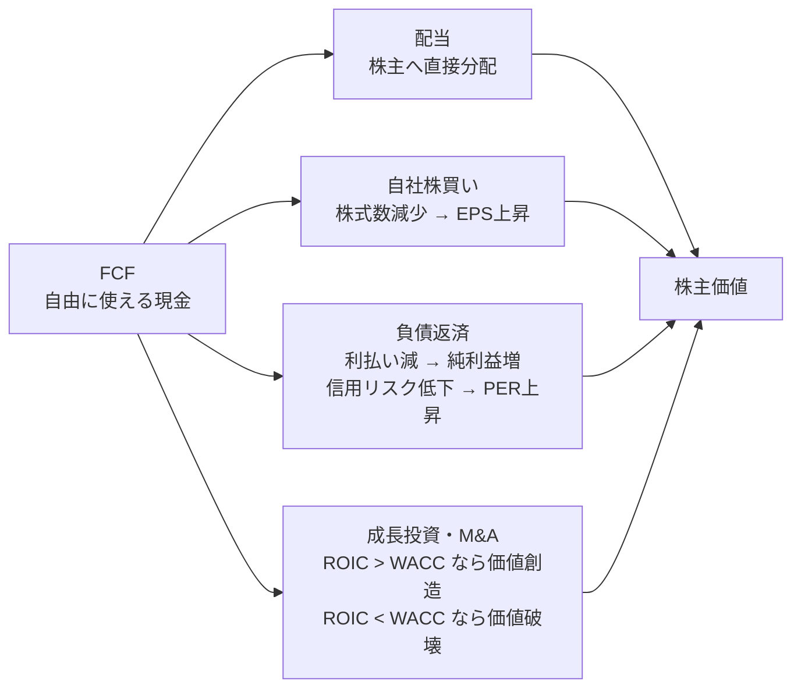
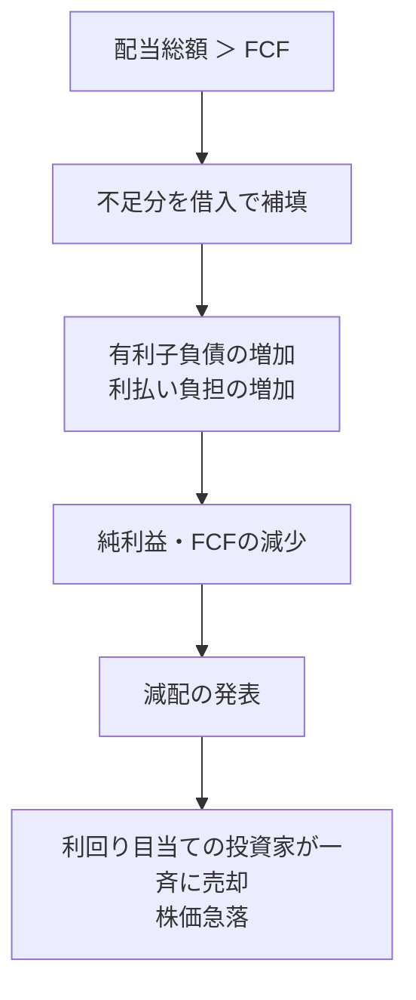
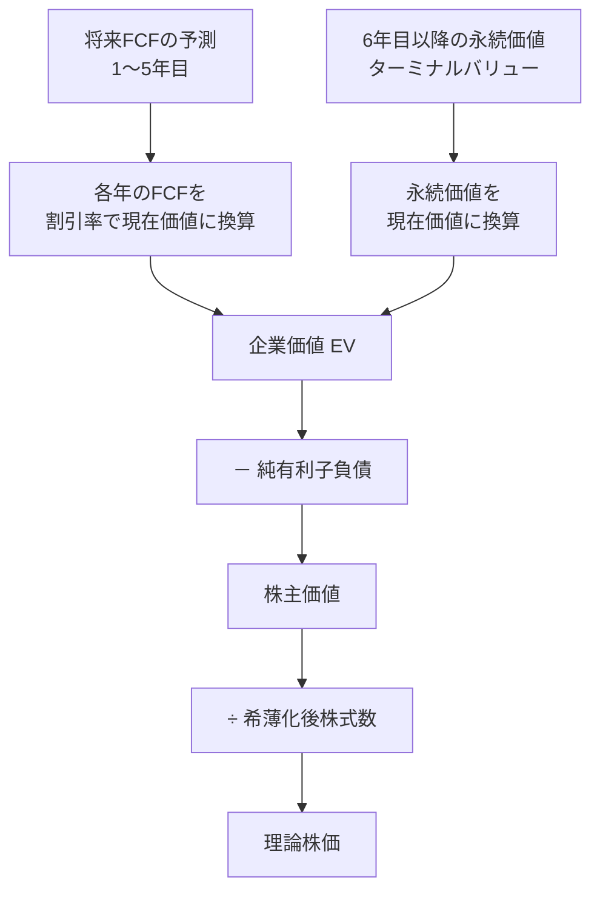

### 8-1 定義と純利益との違い

> **FCF ＝ 営業キャッシュフロー － 設備投資（CapEx）**
> **FCFマージン ＝ FCF ÷ 売上高**
> **FCF転換率 ＝ FCF ÷ 純利益**
> **FCF利回り ＝ FCF ÷ 時価総額**（P/FCF ＝ その逆数）

純利益は会計上の利益であり、減価償却など現金の動きを伴わない費用や、売掛金・在庫の増減が反映されている。FCFはそれらを調整し、「事業を維持した上で、株主と債権者に自由に分配できる現金」を示す。

| 純利益からFCFへの橋渡し（億ドル） | Apex Retail | Nova Cloud | Ironclad Power |
|---|---:|---:|---:|
| 純利益 | 8.0 | ▲1.0 | 5.5 |
| ＋減価償却費（非現金費用） | ＋2.0 | ＋0.5 | ＋5.0 |
| ＋株式報酬費用（非現金費用） | ＋0.3 | ＋3.0 | ＋0.1 |
| ±運転資本の増減 | ＋1.7 | ▲1.5 | ▲0.1 |
| ＝ 営業キャッシュフロー | 12.0 | 1.0 | 10.5 |
| －設備投資 | ▲3.0 | ▲0.5 | ▲8.0 |
| **＝ FCF** | **9.0** | **0.5** | **2.5** |
| FCFマージン | 9.0% | 2.5% | 5.0% |
| FCF転換率 | 112.5% | ―（赤字） | 45.5% |
| FCF利回り | 7.5% | 0.25% | 4.2% |
| P/FCF | 13.3x | 400x | 24.0x |

{{chart:c10_fcf_bridge}}

3社の対比が本質を示している。Apex Retailは純利益8.0億に対しFCF 9.0億で、**利益の全額以上が現金として手元に残る**。Ironclad Powerは純利益5.5億に対しFCFはわずか2.5億で、利益の半分以上が発電設備の更新投資（CapEx 8.0億）に消える。**PERではIronclad（10.9x）がApex（15.0x）より割安に見えるが、P/FCFではIronclad（24.0x）がApex（13.3x）より大幅に割高である**。株主が実際に受け取れる現金で評価すれば、優劣は逆転する。

### 8-2 FCFの使途 — 株主価値に還元される4つの経路

Apex RetailのFCF 9.0億ドルは、当年度に次のように配分された。

{{chart:c30_fcf_allocation}}

FCFの91%（8.2億ドル）が株主還元に回り、残りで負債を圧縮している。これは成熟企業の理想的な資本配分に近い。投資家がこの配分を評価する際の基準は、「自社株買いが理論株価より安い水準で行われているか」（4-3節）と「成長投資のROICがWACCを上回っているか」（6-5節）の2点である。

### 8-3 配当の持続性はFCFで判定する — Ironclad Powerの構造的問題

配当利回りの高さに惹かれて投資する前に、配当がFCFで賄えているかを確認する。

> **FCFベース配当性向 ＝ 配当総額 ÷ FCF**

| 企業 | 配当総額 | FCF | FCFベース配当性向 | 純利益ベース配当性向 | 判定 |
|---|---:|---:|---:|---:|---|
| Apex Retail | 3.2億 | 9.0億 | **36%** | 40% | 持続可能、増配余力大 |
| Ironclad Power | 4.0億 | 2.5億 | **160%** | 73% | **FCFで賄えず、不足1.5億を借入で補填** |

Ironclad Powerは、純利益ベースの配当性向73%を見ると「やや高いが電力会社としては通常」に映る。しかしFCFベースでは160%で、配当のために毎年借入を増やしている（キャッシュフロー計算書の「有利子負債の純増減 ＋1.5億」がその証拠である）。この構造は、金利上昇か設備投資の増加で必ず限界を迎え、減配に至る。

**高配当株の投資判断は、配当利回りではなくFCFベース配当性向で行う**。目安は、一般事業会社で60%以下、公益・REIT等の安定事業で80%以下である。

### 8-4 株式報酬（SBC）とFCFの修正

米国のテクノロジー企業では、従業員報酬の大部分を株式で支払う。SBCは損益計算書では費用だが、現金支出を伴わないため営業CFに足し戻され、FCFを押し上げる。しかし株主は希薄化という形で確実にそのコストを負担している。

| Nova Cloud | 開示FCF | SBC | SBC控除後FCF | 意味 |
|---|---:|---:|---:|---|
| 年間 | 0.5億 | 3.0億 | **▲2.5億** | 現金ベースでは黒字に見えるが、株主負担を含めれば赤字 |

SBCを「現金流出ではないから無視してよい」とする考え方は、次の理由で誤りである。企業がSBCを現金給与に置き換えれば営業CFは3.0億減少する。SBCを続ければ株式数が年5%増え、既存株主の持分は5年で22%希薄化する（1 ÷ 1.276 ＝ 0.78）。**いずれの経路でも株主は同額のコストを負担する**。厳格な評価では「FCF － SBC」を用いるか、希薄化後の株式数でDCFを計算する。

### 8-5 DCF（割引キャッシュフロー法）— 理論株価を自分で計算する

FCFを使えば、企業の理論株価（内在価値）を算出できる。「将来のFCFを、リスクに見合った割引率で現在価値に引き直し、合計する」のがDCFの原理である。

**Apex Retailの2段階DCF（前提）**

- 1〜5年目：FCFが年率8%で成長（基準9.0億ドル）
- 6年目以降：永続成長率 g ＝ 3%
- 割引率（WACC）r ＝ 9%
- 純有利子負債 10億ドル、株式数1.00億株

| 年 | FCF（億ドル） | 割引係数 ＝ 1 ÷ (1.09)^年 | 現在価値（億ドル） |
|---:|---:|---:|---:|
| 1 | 9.72 | 0.917 | 8.92 |
| 2 | 10.50 | 0.842 | 8.84 |
| 3 | 11.34 | 0.772 | 8.75 |
| 4 | 12.24 | 0.708 | 8.67 |
| 5 | 13.22 | 0.650 | 8.59 |
| **1〜5年目の現在価値合計** | | | **43.8** |
| ターミナルバリュー（6年目以降） | 13.22 × 1.03 ÷ (0.09 － 0.03) ＝ 227.0 | 0.650 | **147.5** |
| **企業価値（EV）** | | | **191.3** |
| － 純有利子負債 | | | ▲10.0 |
| **株主価値** | | | **181.3** |
| ÷ 株式数 1.00億株 | | | **理論株価 $181** |

理論株価$181に対し、現在株価は$120である。**安全域（Margin of Safety）＝ (181 － 120) ÷ 181 ＝ 34%**。グレアムの基準では、理論株価に対して25〜33%以上の安全域があれば投資に値する。

ただし、この結果は前提に強く依存する。特に企業価値の77%（147.5 ÷ 191.3）がターミナルバリュー、すなわち6年目以降の遠い将来に依存しており、rとgのわずかな違いで大きく変動する。感応度分析が不可欠である。下の計算機で r と g を動かすと、理論株価がどれだけ動くかを確かめられる。

| 割引率 r ＼ 永続成長率 g | g ＝ 2% | g ＝ 3% |
|---:|---:|---:|
| **8%** | $188 | $220 |
| **9%** | $159 | **$181** |
| **10%** | $137 | $153 |
| **11%** | **$120** | $133 |

{{chart:c11_dcf_sensitivity}}

この感応度表から、投資判断上もっとも重要な情報が得られる。**現在の株価$120は、「割引率11%・永続成長率2%」という悲観的な前提で初めて正当化される**。言い換えれば、市場はApex Retailに対して、成熟小売企業としてはかなり高いリスクプレミアムと低い長期成長を織り込んでいる。もし投資家が「割引率9%・成長率2〜3%は十分に達成可能」と判断できるなら、$120は理論株価$159〜181に対して割安であり、安全域は25〜34%となる。DCFは「正確な株価」を出す道具ではなく、**「現在の株価が織り込む前提」を明示し、その前提の妥当性を自分で判断する道具**である。

### 8-6 FCF利回りと債券利回り — 資産クラス間の比較

FCF利回りは、株式を「変動する利率の債券」として債券と比較することを可能にする。

| 資産（例） | 利回り | 特徴 |
|---|---:|---|
| 米10年国債（仮定） | 4.5% | 元本・利息とも確定、成長なし |
| Apex Retail FCF利回り | 7.5% | 利回りが年率8〜10%で成長する見込み |
| Ironclad Power FCF利回り | 4.2% | 国債を下回る。株式リスクに見合わない |
| Nova Cloud FCF利回り | 0.25% | 現在の現金創出力はほぼゼロ、将来の成長のみに依存 |

Apex RetailのFCF利回り7.5%は国債を3ポイント上回り、かつ成長する。Ironclad PowerのFCF利回り4.2%は国債を下回っており、配当利回り6.67%との差（＝借入で払っている配当）が、この企業の配当の脆弱性を数値として示している。**配当利回りがFCF利回りを大きく上回る企業は、配当の一部を株主資本または借入から支払っている**。

### 8-7 オーナー利益と設備投資の分解

バフェットが提唱した「オーナー利益」は、設備投資を「維持投資」と「成長投資」に分けて、事業維持に必要な分だけを控除する考え方である。

> **オーナー利益 ＝ 純利益 ＋ 減価償却費 － 維持設備投資**

| 企業 | 純利益 | ＋D&A | 設備投資合計 | うち維持投資（推定） | うち成長投資 | オーナー利益 |
|---|---:|---:|---:|---:|---:|---:|
| Apex Retail | 8.0 | 2.0 | 3.0 | 2.0 | 1.0 | **8.0** |
| Ironclad Power | 5.5 | 5.0 | 8.0 | 6.0 | 2.0 | **4.5** |

Ironclad Powerは減価償却5.0億に対し維持投資に6.0億を要しており、設備の老朽化が進んでいる可能性を示す。**減価償却費を維持投資が恒常的に上回る企業は、会計上の利益が実態を過大表示している**。10-KのMD&A（経営者による分析）で設備投資の内訳を確認する。

> **投資判断への直結**
> - PERとP/FCFの両方を確認する。両者が大きく乖離する企業は、利益の現金化に問題があるか、設備投資が重い。
> - 配当の持続性はFCFベース配当性向で判定する。100%超は減配リスクが高い。
> - SBCが大きい企業は「FCF － SBC」で再評価する。
> - DCFは理論株価の算出より、「現在の株価が織り込む割引率と成長率」を逆算する道具として使い、安全域を確保して買う。
