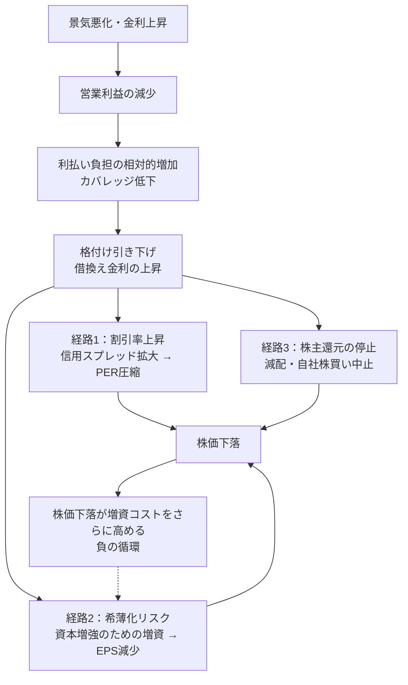

### 9-1 定義と関連指標

> **自己資本比率 ＝ 自己資本 ÷ 総資産**
> **D/Eレシオ ＝ 有利子負債 ÷ 自己資本**
> **純有利子負債/EBITDA ＝ （有利子負債 － 現金） ÷ EBITDA**（借金を何年分の利益で返せるか）
> **インタレスト・カバレッジ・レシオ ＝ 営業利益 ÷ 支払利息**（利払いの余裕度）

| 指標 | Apex Retail | Nova Cloud | Ironclad Power |
|---|---:|---:|---:|
| 自己資本比率 | **50.0%** | **75.0%** | **26.7%** |
| D/Eレシオ | 0.40 | 0.00 | 2.00 |
| 純有利子負債/EBITDA | 0.8x | ネットキャッシュ | **5.1x** |
| インタレスト・カバレッジ | 11.0x | ―（無借金） | **3.3x** |
| 現金 ÷ 年間営業赤字 | ― | 12.5年分（25 ÷ 2.0） | ― |

財務健全性の指標は、単独で株価を「上げる」ことはない。しかし、**財務が脆弱な企業は、景気後退・金利上昇・一時的な業績不振のいずれかで株主資本を失い、複利の連鎖を断ち切る**。長期投資において財務健全性は、リターンの源泉ではなく「生存条件」である。

### 9-2 業種別の目安

自己資本比率の適正水準は、事業のキャッシュフローの安定性と資産の性質で決まる。

| 業種 | 自己資本比率の概ねの目安 | 純有利子負債/EBITDAの目安 | 理由 |
|---|---:|---:|---|
| ソフトウェア・クラウド | 60〜80% | ネットキャッシュ | 有形資産が少なく、借入の必要性が低い |
| 製造業 | 35〜50% | 1〜2x | 設備投資を一部借入で賄う |
| 小売 | 30〜45% | 1〜2x | 店舗リース債務が負債に計上される |
| 通信 | 25〜40% | 2〜3x | 安定収入を担保に設備を借入で構築 |
| 公益 | 25〜35% | 4〜5x | 規制で収益が保証され、高レバレッジが許容される |
| 銀行 | 8〜12% | ―（別指標CET1比率を使用） | 預金が負債であるため構造的に低い |

Ironclad Powerの自己資本比率26.7%、純有利子負債/EBITDA 5.1xは、公益企業としては許容範囲の上限にある。**「業種の標準内」と「安全」は同義ではない**。規制事業でも、金利が上昇すれば80億ドルの借換えコストは確実に増加する。

### 9-3 レバレッジの数学 — 資産価値の20%下落が株主資本に与える影響

自己資本は「資産 － 負債」の残余であり、負債は減らないため、資産価値の下落はすべて株主資本が吸収する。

| 資産価値が20%下落した場合 | Apex Retail | Nova Cloud | Ironclad Power |
|---|---:|---:|---:|
| 下落前の総資産 | 100.0 | 40.0 | 150.0 |
| 下落後の総資産 | 80.0 | 32.0 | 120.0 |
| 負債（不変） | 50.0 | 10.0 | 110.0 |
| 下落後の自己資本 | 30.0 | 22.0 | 10.0 |
| **自己資本の減少率** | **▲40%** | **▲27%** | **▲75%** |

Ironclad Powerは資産価値が20%下がるだけで株主資本の4分の3を失う。あと数ポイントの下落で債務超過に転落する。財務レバレッジ3.75倍（第6章）でROEを膨らませていた代償がここに現れる。株価はこの構造を織り込んでおり、レバレッジの高い企業ほど業績悪化局面での株価下落率が大きい。

### 9-4 ストレステスト — 営業利益が半減したとき何が起こるか

景気後退で3社の営業利益がそれぞれ50%減少した場合を試算する（Nova Cloudは営業赤字が▲2.0億から▲3.0億に1.5倍へ拡大すると置く）。

| 営業利益▲50%シナリオ | Apex Retail | Nova Cloud | Ironclad Power |
|---|---:|---:|---:|
| 営業利益（半減後） | 5.5 | ▲3.0 | 5.0 |
| 支払利息 | 1.0 | 0.0 | 3.0 |
| 税引前利益 | 4.5 | ▲3.0 | 2.0 |
| 純利益 | 3.6 | ▲3.0 | 1.6 |
| EPS | $3.60（▲55%） | ▲$3.00 | $0.79（▲71%） |
| インタレスト・カバレッジ | 5.5x（安全圏） | ― | **1.7x（危険水域）** |
| 配当総額 vs 純利益 | 3.2 vs 3.6（維持可能） | 無配 | **4.0 vs 1.6（減配不可避）** |
| 現金の持続年数 | ― | 25 ÷ 3.0 ＝ 8年（十分） | ― |

{{chart:c12_leverage_stress}}

営業利益の減少率は同じ50%でも、EPSの減少率はApexが55%、Ironcladが71%である。**固定的な支払利息が、営業利益の変動を純利益に増幅して伝える**（財務レバレッジ効果）。Ironclad Powerはインタレスト・カバレッジが1.7xまで低下し、多くの融資契約に含まれる財務制限条項（コベナンツ、一般に2.0〜2.5x以上を要求）に抵触する水準に近づく。Nova Cloudは赤字が拡大しても無借金で現金が8年分あり、財務面の危機には至らない。**高い自己資本比率とネットキャッシュは、成長企業が景気後退を「投資の好機」として生き延びるための条件**である。

### 9-5 財務健全性が株価に効く3つの経路

| 経路 | メカニズム | 数値例（Ironclad Power） |
|---|---|---|
| 割引率上昇 | 信用リスク上昇 → 株主が要求するリスクプレミアム拡大 → 妥当PER低下 | 割引率が7%から9%に上昇するとDCF理論株価は大幅に低下 |
| 希薄化 | 自己資本比率の回復のため増資 → 株式数増加 → EPS減少 | 自己資本を10億ドル増強するため株価$20で5,000万株を発行すると、株式数は25%増加しEPSは20%減少 |
| 還元停止 | 配当・自社株買いの停止 → インカム投資家の売却 | 減配発表で利回り目当ての保有者が一斉に売却 |

これらの経路は互いに強め合う。株価が下落すると増資に必要な発行株数が増え、希薄化が拡大し、株価がさらに下がる。**財務危機に陥った企業の株価が「割安に見える水準」からさらに下落し続けるのは、この負の循環による**。低PBR・低PERであることは、財務危機の企業を買う理由にならない。

### 9-6 レバレッジの肯定的側面と最適資本構成

負債が常に悪いわけではない。借入金利が税引後で3%、ROICが14.7%（Apex Retail）なら、借入で調達した資本は差額11.7ポイント分の価値を株主に生む。適度な負債は、(1) 支払利息の損金算入による節税、(2) 低コストの資本によるROE向上、(3) 経営規律の強化、という利点を持つ。

| 資本構成 | 利点 | 欠点 | 適合する企業 |
|---|---|---|---|
| 無借金・ネットキャッシュ | 景気後退に強い、機動的な投資が可能 | 資本コストが高く、ROEが低くなりがち | 高成長企業、利益変動の大きい企業 |
| 適度な負債（純有利子負債/EBITDA 1〜2x） | ROE向上、節税、規律 | 金利上昇の影響を受ける | 成熟した安定企業 |
| 高レバレッジ（3x超） | 好況時のROE極大化 | 不況時に株主資本を失う | 規制事業、極めて安定したキャッシュフローを持つ企業のみ |

判断の基準は「負債の水準」ではなく、「**利益が半減しても利払いと元本返済を継続できるか**」である。9-4節のストレステストを、投資対象のすべての企業について行う。

> **投資判断への直結**
> - 自己資本比率・純有利子負債/EBITDA・インタレスト・カバレッジの3指標を業種の目安と照合し、営業利益半減時のカバレッジが3x以上を維持できるかを確認する。
> - 財務レバレッジで膨らんだROEと配当利回りは、業績悪化時に急速に失われる。
> - 低PER・低PBRの財務脆弱企業は、割引率上昇・希薄化・還元停止の負の循環でさらに下落しうる。
> - ネットキャッシュを持つ企業は景気後退で競争優位を拡大できる。財務健全性は防御であると同時に、長期の攻撃力でもある。
