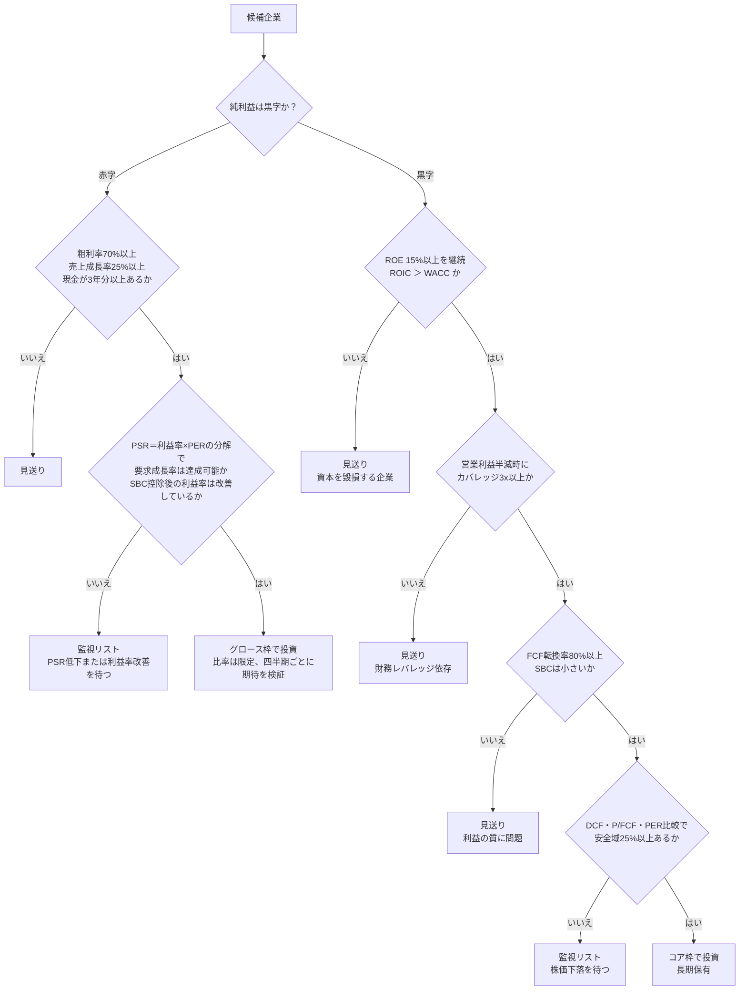

### 11-1 総合スコアカード — 3社の全指標

| 指標 | Apex Retail | Nova Cloud | Ironclad Power | 章 |
|---|---:|---:|---:|---|
| **成長** | | | | |
| 売上成長率 | +6% | +40% | +2% | 4 |
| EPS成長率（予想） | 10% | ―（赤字） | 3% | 4 |
| 持続可能成長率 | 9.6% | ― | 3.75% | 6 |
| **収益性・質** | | | | |
| 粗利率 | 35% | 75% | 50% | 7 |
| 営業利益率 | 11% | ▲10% | 20% | 4 |
| ROE | 16.0% | ▲3.3% | 13.75% | 6 |
| ROIC vs WACC | 14.7% vs 9.0%（＋5.7pt） | ― | 6.7% vs 7.0%（▲0.3pt） | 6 |
| FCF転換率 | 112.5% | ― | 45.5% | 8 |
| SBC ÷ 売上高 | 0.3% | 15.0% | 0.2% | 8 |
| **バリュエーション** | | | | |
| PER（実績／予想） | 15.0x／13.6x | 算出不能 | 10.9x／10.6x | 5 |
| PEG | 1.50 | ― | 3.64 | 5 |
| PBR | 2.4x | 6.67x | 1.5x | 6 |
| PSR／EV/Sales | 1.2x／1.3x | 10.0x／8.75x | 1.2x／2.7x | 7 |
| P/FCF・FCF利回り | 13.3x・7.5% | 400x・0.25% | 24.0x・4.2% | 8 |
| DCF理論株価（基準ケース） | $181（安全域34%） | シナリオ依存 | ― | 8 |
| **財務健全性** | | | | |
| 自己資本比率 | 50.0% | 75.0% | 26.7% | 9 |
| 純有利子負債/EBITDA | 0.8x | ネットキャッシュ | 5.1x | 9 |
| インタレスト・カバレッジ | 11.0x | 無借金 | 3.3x | 9 |
| **株主還元** | | | | |
| 配当利回り | 2.67% | 0% | 6.67% | 8 |
| FCFベース配当性向 | 36% | ― | 160% | 8 |

### 11-2 バリュー投資の判断手順（Graham → Buffett → Morningstar）

バリュー投資は「価格と価値の乖離を買う」戦略であり、判断は次の順序で行う。

| 手順 | 問い | 使う指標 | 合格基準（目安） | Apex Retail |
|---|---|---|---|---|
| 1. 質の確認 | 資本コストを上回るリターンを継続的に生んでいるか | ROE、ROIC vs WACC、粗利率の推移 | ROE 15%以上を5年継続、ROIC ＞ WACC | 合格（ROE 16%、スプレッド＋5.7pt） |
| 2. モートの確認 | 高い資本効率を守る競争優位があるか | 粗利率・営業利益率の安定性、市場シェア | 利益率が競争で侵食されていない | 要確認（10-Kの競争環境の記述で検証） |
| 3. 財務の確認 | 景気後退を無傷で乗り切れるか | 自己資本比率、純有利子負債/EBITDA、カバレッジ | 営業利益半減時にカバレッジ3x以上 | 合格（半減時5.5x） |
| 4. 利益の質 | 利益が現金化されているか | FCF転換率、SBC、営業CF vs 純利益 | FCF転換率80%以上 | 合格（112.5%） |
| 5. 価値の推定 | 理論株価はいくらか | DCF、P/FCF、PERの自社履歴・業種比較 | 複数手法で妥当レンジを設定 | $159〜181（r 9%、g 2〜3%） |
| 6. 安全域 | 価格は価値をどれだけ下回るか | （理論株価－株価）÷ 理論株価 | 25%以上 | 合格（25〜34%） |
| 7. 織り込み期待の検証 | 現在の株価が前提とする条件は悲観的すぎないか | DCF感応度の逆算 | 市場の前提が達成容易であること | $120はr 11%・g 2%を前提（悲観的） |

Apex Retailは全手順で合格圏にあり、バリュー投資の対象として成立する。判断の残された論点は手順2のモート（この優位が今後10年続くか）であり、これは数値ではなく事業内容の理解で判断する。

### 11-3 グロース投資の判断手順（Fisher → Lynch → Mauboussin）

グロース投資は「将来の利益が現在の価格を正当化する」ことに賭ける戦略であり、判断の重心は「期待の現実性」にある。

| 手順 | 問い | 使う指標 | 合格基準（目安） | Nova Cloud |
|---|---|---|---|---|
| 1. 市場機会 | 成長を10年続けられる市場規模があるか | TAM、市場シェア | 現在の売上がTAMの10%未満 | 要確認（10-Kの市場記述で検証） |
| 2. 成長の質 | 成長は既存顧客の拡大に支えられているか | NRR、粗利率、顧客数の推移 | NRR 110%以上、粗利率70%以上 | 粗利率合格、NRRは開示を要確認 |
| 3. 収益化の道筋 | 規模拡大で利益率が改善しているか | 営業利益率の推移、Rule of 40 | 利益率が毎年改善、Rule of 40合格 | 不合格（SBC控除後スコア27.5） |
| 4. 希薄化 | 株主の持分が守られているか | 株式数増加率、SBC ÷ 売上高 | 希薄化3%未満、SBC 10%未満 | 不合格（5%、15%） |
| 5. 財務の持続性 | 黒字化まで資金が持つか | 現金 ÷ 年間赤字 | 3年以上 | 合格（10年） |
| 6. 織り込み期待の逆算 | 現在の株価が要求する成長率は達成可能か | PSR＝利益率×PERの分解、シナリオ分析 | 必要成長率が過去実績・市場成長と整合 | 要求CAGR 32.7%（現在40%だが減速中） |
| 7. 非対称性の確認 | 上振れと下振れの幅は見合っているか | ブル／ベアシナリオの株価 | 上振れ幅が下振れ幅を明確に上回る | ブル＋20%/年 vs ベア▲21%/年（対称的） |

Nova Cloudは市場機会と財務の持続性では合格するが、収益化の道筋と希薄化で不合格であり、現在の株価が要求する年率33%成長は達成不確実である。**グロース投資として成立するのは、株価が下落してPSRが4〜5x程度になり、要求成長率が20%前後まで下がった局面**、あるいはSBC控除後の利益率改善が確認された局面である。指標は「買わない理由」だけでなく、「いくらなら買えるか」を示す。

### 11-4 インカム投資の判断 — Ironclad Powerは配当の罠か

| 手順 | 問い | 使う指標 | Ironclad Power |
|---|---|---|---|
| 1. 配当の原資 | 配当はFCFで賄えているか | FCFベース配当性向 | **不合格（160%）** |
| 2. 財務の余力 | 借入で配当を支えていないか | 有利子負債の推移、純有利子負債/EBITDA | **不合格（借入増加、5.1x）** |
| 3. 利払い耐性 | 金利上昇・利益減少に耐えられるか | インタレスト・カバレッジ、ストレステスト | **不合格（半減時1.7x）** |
| 4. 資本効率 | 事業が価値を創造しているか | ROIC vs WACC | **不合格（▲0.3pt）** |
| 5. 成長 | 増配の余地があるか | 持続可能成長率 | 3.75%（限定的） |

配当利回り6.67%とPER 10.9xという表面的な数字は魅力的に見えるが、5項目中4項目で不合格である。**Ironclad Powerは典型的な「配当の罠（ディビデンド・トラップ）」であり、減配時の株価下落で配当収入を上回る損失が発生する可能性が高い**。インカム投資の対象として成立するのは、Apex Retailのように配当利回りが低くても（2.67%）、FCFベース配当性向が低く（36%）、増配余力（持続可能成長率9.6%）がある企業である。10年後の配当は、Apexが年率10%増配なら$8.30（当初投資額に対する利回り6.9%）となり、Ironcladの現在利回りを上回る。

### 11-5 投資判断フローチャート

### 11-6 3社の位置づけ

{{chart:c27_quadrant}}

Ironclad Powerは左下（割安・低成長）に位置するが、11-4節の通り「割安」は財務リスクの反映であり、バリュー候補としての検証で不合格となる。Apex Retailは中央やや左下にあり、成長率10%を安全域付きで買える、右下の領域に最も近い。Nova Cloudは右上の期待先行ゾーンにあり、株価がこの位置から右下へ移動する（成長を維持したまま倍率が低下する）局面が投資機会となる。

### 11-7 ポジション設計と売却基準

| 項目 | 基準（目安） | 根拠 |
|---|---|---|
| 個別株1銘柄の上限 | ポートフォリオの5〜10% | 1銘柄の▲50%が全体の▲5%以内に収まる（第10章4節） |
| 高PSR成長株の合計上限 | 15〜20% | 二重下落リスクの集中を避ける（第7章5節） |
| 同一業種の上限 | 25% | 業種固有の金利・規制リスクの分散 |
| コア（インデックスETF・優良企業）の比率 | 60%以上 | 長期リターンの源泉は市場全体のEPS成長（第10章3節） |
| 現金比率 | 5〜15% | 安全域が生じた局面で買える待機資金 |

売却は「株価が上がったから」「下がったから」ではなく、**投資テーゼが崩れたとき**、または**価格が価値を大幅に超えたとき**に行う。

| 売却基準 | 具体的なシグナル | 該当章 |
|---|---|---|
| テーゼの崩壊（質） | ROEが3四半期連続で低下し、原因が純利益率の悪化にある | 6 |
| テーゼの崩壊（現金） | FCF転換率が80%を下回り続ける、FCFベース配当性向が100%を超える | 8 |
| テーゼの崩壊（財務） | 純有利子負債/EBITDAが3x超に上昇、格付け引き下げ | 9 |
| テーゼの崩壊（成長） | 高PSR株の売上成長率が2四半期連続で大幅減速、NRR低下 | 7 |
| 価格が価値を超過 | 株価がDCF理論株価の上限を30%以上上回る、PERが自社履歴の最高値圏 | 5, 8 |
| 資本配分の劣化 | 割高な株価での大型自社株買い、ROIC ＜ WACC の大型買収 | 4, 6 |

### 11-8 指標変化の早期警戒サイン

株価が反応する前に財務諸表に現れる兆候を、指標ごとに整理する。

| 警戒サイン | 何が起きている可能性が高いか | 株価への典型的な影響 |
|---|---|---|
| 売上は伸びるが売掛金が売上以上に増加 | 押し込み販売、回収遅延 | 数四半期後の減収・貸倒れで急落 |
| 純利益は伸びるが営業CFが横ばい・減少 | 利益の質の低下、運転資本の悪化 | FCF利回り低下 → 評価の切り下げ |
| 粗利率の連続的低下 | 価格競争、コスト転嫁力の喪失（モート侵食） | ROE低下 → PBR・PER両方の低下 |
| 非GAAP利益とGAAP利益の差の拡大 | 「一時費用」の常態化 | 質の低いEPSとして割引評価 |
| 在庫の売上比が上昇 | 需要減速、陳腐化リスク | 評価損計上で減益 |
| 株式数の継続的増加 | SBC過大、増資による資金調達 | 1株当たり価値の希薄化 |
| 減価償却費を維持設備投資が恒常的に上回る | 設備老朽化、会計利益の過大表示 | FCFの構造的低下 |
| インタレスト・カバレッジの低下 | 借入増加または利益減少 | 割引率上昇・減配リスク |
| ガイダンスの「上限のみ達成」「据え置き」の連続 | 成長の減速を経営陣が認識 | 高PSR株で倍率圧縮 |
| 経営陣の自社株売却の増加 | 内部者が現在の株価を高いと判断 | 中期的な下落の先行指標 |

### 11-9 開示資料のどこを見るか — 10-K・10-Qの読み方

米国上場企業は年次報告書（Form 10-K）と四半期報告書（Form 10-Q）をSECのEDGARで開示している。第II部の指標を算出・検証するために参照すべき箇所を示す。

| 10-Kの項目 | 内容 | 本書の指標との対応 |
|---|---|---|
| Item 1. Business | 事業内容、製品、競争環境、顧客 | モート（11-2手順2）、市場機会（11-3手順1）の質的検証 |
| Item 1A. Risk Factors | リスク要因 | 経営陣が認識する脅威の一覧。前年からの変化に注目 |
| Item 7. MD&A | 経営者による財政状態・経営成績の分析 | 売上・利益率変動の要因、設備投資の内訳（維持／成長）、流動性、ガイダンス |
| Item 8. Financial Statements | 損益計算書・貸借対照表・キャッシュフロー計算書・注記 | 全指標の一次データ。注記でSBC、負債の満期構成、リース債務を確認 |
| Item 5. Market for Common Equity | 株主還元、自社株買いの実施状況 | 自社株買いの金額と平均取得価格（4-3節） |
| Item 9A. Controls and Procedures | 内部統制の有効性 | 「重大な欠陥」の記載は会計の信頼性への警告 |
| Proxy Statement（DEF 14A） | 役員報酬、株主提案 | 報酬がROIC・FCFなど価値創造指標に連動しているか |
| Form 4 | 内部者の売買 | 11-8節の経営陣売却シグナル |

四半期ごとの決算発表では、プレスリリース（Form 8-K添付）と決算説明会（Earnings Call）の質疑応答が、ガイダンスと経営陣の需要認識を把握する上での一次情報となる。アナリストの質問に対する経営陣の回答の「歯切れ」は、数値に現れる前の変化を捉える手がかりになる。

| 決算発表資料 | 確認する順序 | 確認内容 |
|---|---|---|
| プレスリリース冒頭 | 1 | 売上・希薄化後EPSの実績とコンセンサスの差 |
| ガイダンス欄 | 2 | 通期・翌四半期の売上・EPS予想の方向（引き上げ／据え置き／引き下げ） |
| キャッシュフロー計算書 | 3 | 営業CF、設備投資、FCF、自社株買い、配当 |
| 貸借対照表 | 4 | 現金、有利子負債、売掛金・在庫の売上比 |
| 決算説明会Q&A | 5 | 需要環境、価格動向、競争、利益率見通しに関する経営陣の発言 |
| 株式数 | 6 | 希薄化後加重平均株式数の前年比 |

> **投資判断への直結**
> - 判断は「バリュー」「グロース」「インカム」のどの枠で買うのかを先に決め、その枠の手順で検証する。
> - 黒字企業は質→財務→利益の質→安全域の順に、赤字成長企業は期待の逆算と希薄化を中心に見る。
> - 売却はテーゼの崩壊か、価格が価値を大幅に超えたときに限る。株価の上下そのものは売却理由にならない。
> - 早期警戒サインは株価より先に財務諸表に現れる。決算ごとに11-1のスコアカードを更新する。
