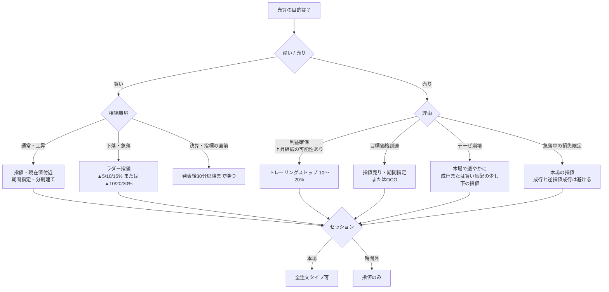

### 13-1 板（気配値情報）の構造

**「板」とは気配値情報のことである。** 特定の銘柄について、いくらで・どれだけ売りたい人と買いたい人がいるかを、価格別に一覧表示したものを指す。現在値を挟んで、上に売り注文（この価格で売りたい＝Ask／Offer）、下に買い注文（この価格で買いたい＝Bid）が価格順に並ぶ。すべての注文は取引所の板で処理され、売り注文と買い注文の価格が一致したときに約定する。

{{chart:c24_order_book}}

| 用語 | 意味 | 上図での例 |
|---|---|---|
| 売り気配（Ask／Offer） | その価格で売りたい注文の数量 | $120.05に4,800株、$120.10に3,100株 |
| 買い気配（Bid） | その価格で買いたい注文の数量 | $119.95に5,200株、$119.90に3,600株 |
| 最良売り気配（Best Ask） | 売り注文のうち最も安い価格 | $120.05 |
| 最良買い気配（Best Bid） | 買い注文のうち最も高い価格 | $119.95 |
| スプレッド | 最良売り気配と最良買い気配の差 | $0.10（現在値の0.08%） |
| 現在値（Last） | 直近に約定した価格 | $120.00 |
| 板の厚み（Depth） | 各価格に積まれた注文数量 | $119.95の5,200株が最も厚い |
| 歩み値（Time & Sales） | 約定の履歴（時刻・価格・数量） | 13-3節 |

米国株では、複数の取引所と私設取引システムの気配が統合され、全市場で最も良い売り気配と買い気配が**NBBO（National Best Bid and Offer：全米最良気配）**として表示される。表示される気配は原則としてラウンドロット（通常100株、高株価銘柄ではより小さい単位）の注文に基づく。証券会社が個人投資家に提供する板は、最良気配のみ（Level 1）か、上下数本〜十数本の気配（Level 2）かが会社・契約によって異なる。

| 注文の種類 | 板上での動き | 約定価格 |
|---|---|---|
| 指値注文（買い） | 指定価格で板に「並ぶ」。売り注文がその価格まで下りてきたら約定 | 指定価格以下 |
| 成行注文（買い） | 板の売り注文を最良価格から順に「食う」。数量が大きいと複数の価格帯にまたがる | その時点の売り気配（複数価格の平均） |

成行注文は「約定の確実性」を、指値注文は「価格の確実性」を優先する。両方を同時には得られない。板が厚い（注文数量が多い）大型株の本場では、成行でもスプレッド分のコストで済むが、板が薄い時間外や小型株では、成行注文が想定より大きく不利な価格で約定する（スリッページ）。

### 13-2 板の読み方 — 3つのポイント

板を読むときに見るポイントは主に3つある。

**① 最良気配とスプレッド — 流動性の判定**

現在値のすぐ上の売り最安値と、すぐ下の買い最高値の差がスプレッドである。**スプレッドが狭い＝流動性が高く売買が成立しやすい銘柄、広い＝薄商い**と判断する。スプレッドは投資家が必ず負担する「見えないコスト」であり、成行で買ってすぐ成行で売れば、スプレッド分だけ確実に損をする。

| 銘柄の種類（例） | 株価 | 典型的なスプレッド | 現在値比 | 判断 |
|---|---:|---:|---:|---|
| 大型ETF・大型株（本場） | $120.00 | $0.01〜0.05 | 0.01〜0.04% | 成行でも実質コストは小さい |
| 中型株（本場） | $120.00 | $0.05〜0.20 | 0.04〜0.17% | 指値を基本にする |
| 小型株・時間外 | $120.00 | $0.30〜2.00 | 0.25〜1.7% | 成行は禁止。指値のみ |

**② 板の厚み（数量） — 「壁」の位置**

ある価格に大量の注文が積まれていると、そこが「壁」になって株価が抜けにくい。例えば$120.05の売りに4,800株、$119.95の買いに5,200株が積まれていれば、株価はいったんこの範囲で止まりやすいと読める。厚みは価格別の数量を累積した「デプスチャート」で見ると直感的に把握できる。

{{chart:c26_depth_chart}}

| 板の状態 | 読み方 | 注文への活かし方 |
|---|---|---|
| 買い板が厚く、売り板が薄い | 下値が支えられ、上に抜けやすい | 買いの指値は厚い買い板の1ティック上（先に約定する） |
| 売り板が厚く、買い板が薄い | 上値が重く、下に抜けやすい | 買うなら厚い売り板が消化されてから。売りの指値は壁の1ティック下 |
| 特定の価格に突出した数量 | 大口の指値、または心理的節目（$100、$150など） | その価格を利確・損切りの基準に使う投資家が多いことを意識する |
| 両側とも薄い | 流動性が低い。小さな注文でも価格が大きく動く | 成行禁止、注文を分割する |

**③ 板の変化（動き） — 大口の意図を推測する**

数量が一気に増減したり、注文が板から消えたりする動きは、大口投資家の意図（買い上げたい／売り抜けたい）を推測する材料になる。

| 動き | 推測される背景 |
|---|---|
| 売り板の壁が急に消え、株価が上抜ける | 大口が売り注文を取り下げた、または買いが壁を食い切った |
| 買い板が次々と厚くなる | 買い集めの意図。ただし見せ板の可能性（13-3節） |
| 板は薄いのに歩み値で大口約定が続く | 表示されない注文（アイスバーグ注文）や、板を介さない取引が進行中 |
| 寄付き直後に板が急速に厚くなる | 機関投資家のアルゴリズム注文が稼働。スプレッドは縮小する |

ただし、**個人投資家が見られるのは通常「板情報の一部（気配値上下数本程度）」であり、市場の全体像ではない**点に注意する。米国株では、取引所の板に表示されない注文（アイスバーグ注文、ダークプールでの取引）が多く、上場株式の売買の4〜5割は取引所の板を経由しない。板は「見える注文」だけを映している。

### 13-3 板の限界 — 見せ板と歩み値による検証

**見せ板（スプーフィング）** という手口がある。実際には約定させる気のない大量注文を板に出し、他の投資家の心理を操作して株価を動かそうとする行為で、日本では金融商品取引法（相場操縦）、米国でもドッド・フランク法および証券取引所法のもとで違法とされ、刑事・民事の摘発事例がある。しかし、板の数量が本物かどうかを見た目で判別する方法はない。

**板の数量だけを鵜呑みにせず、実際の約定履歴（歩み値）と照らし合わせる**習慣をつけると精度が上がる。

| 時刻（ET） | 約定価格 | 数量 | 約定方向 | 読み方 |
|---|---:|---:|---|---|
| 10:02:15 | $120.05 | 300 | 買い（売り気配で約定） | 買い手が売り気配を取りに行った |
| 10:02:18 | $120.05 | 1,200 | 買い | 続けて大口の買い |
| 10:02:31 | $120.10 | 2,000 | 買い | 売り板$120.05が食い切られ、次の価格へ |
| 10:02:40 | $120.05 | 500 | 売り（買い気配で約定） | 一部の利確 |

| 板と歩み値の組み合わせ | 解釈 |
|---|---|
| 厚い買い板 ＋ 歩み値で買い約定が続く | 買い意欲は本物。買い板は支えとして機能しやすい |
| 厚い買い板 ＋ 歩み値で売り約定が続き、買い板が減らない | 買い板が「引かれる」可能性。見せ板を疑う |
| 厚い売り板 ＋ 歩み値で買い約定が続き、壁が徐々に消化される | 壁を抜ける可能性が高い |
| 板が薄い ＋ 歩み値で大口約定 | 表示されない注文の存在。板は当てにならない |

長期投資家にとっての板の使い方は、短期の値動きを当てることではない。**(1) 流動性の判定（成行が使える銘柄か）、(2) 指値をどこに置くか（厚い板の1ティック内側）、(3) 決算・指標発表直後にスプレッドが落ち着いたかの確認**の3点に絞ると、板は執行コストを下げる実用的な道具になる。

### 13-4 注文タイプの一覧

| 注文タイプ | 内容 | 約定の確実性 | 価格の確実性 | 主な用途 | 最大のリスク |
|---|---|:---:|:---:|---|---|
| 成行（Market） | 価格を指定せず即時約定 | 高 | 低 | 流動性の高い銘柄を本場で即座に売買 | 寄付き・急変時のスリッページ |
| 指値（Limit） | 指定価格以下で買い／以上で売り | 中 | 高 | 通常の買付・目標価格での売却 | 価格に届かず約定しない |
| 逆指値・成行（Stop） | 指定価格に達したら成行注文を発動 | 高（発動後） | 低 | 損切り、上抜けでの買い | ギャップで発動価格から大きく乖離して約定 |
| 逆指値・指値（Stop-Limit） | 指定価格に達したら指値注文を発動 | 低 | 高 | ギャップで不利な約定を避けたい損切り | 発動しても指値に届かず約定しない |
| トレーリングストップ | 高値から一定率・一定額下落で売り成行を発動。高値更新で発動水準が自動で切り上がる | 高（発動後） | 低 | 上昇トレンド中の利益確保 | 一時的な押しで発動し、その後の上昇を取り逃す |
| OCO | 利確の指値と損切りの逆指値を同時発注。一方が約定すると他方は取消 | ― | ― | 保有中のリスクと目標を同時管理 | 設定幅が狭いとノイズで約定 |
| 条件付き（トリガー）注文 | 価格・時刻などの条件成就で注文を発動 | ― | ― | 条件付きの自動発注 | 条件設計の誤り |

対応する注文タイプと名称は証券会社によって異なる（第12章1節）。

### 13-5 有効期限と取引セッション

| 有効期限 | 内容 | 使い方 |
|---|---|---|
| 当日（Day） | その日の取引終了で失効 | イベント直後など、状況が変わる可能性が高い注文 |
| 期間指定（GTC） | 指定日数まで有効（上限日数は証券会社により異なる） | 押し目待ちの指値、目標価格での利確指値 |

| セッション（米東部時間） | 日本時間（夏） | 日本時間（冬） | 流動性 | スプレッド | 推奨する注文 |
|---|---|---|---|---|---|
| 夜間（時間外取引） | 翌9:00〜17:00頃 | 翌10:00〜18:00頃 | 極めて低い | 広い | 指値のみ。原則として使わない |
| プレマーケット（4:00〜9:30） | 17:00〜22:30 | 18:00〜23:30 | 低い | 広い | 指値のみ |
| 本場（9:30〜16:00） | 22:30〜翌5:00 | 23:30〜翌6:00 | 高い | 狭い | 全注文タイプ。成行はここでのみ |
| アフター（16:00〜20:00） | 翌5:00〜9:00 | 翌6:00〜10:00 | 低い | 広い | 指値のみ。決算直後の値動きを観察する時間帯 |

本場の最初の30分（寄付き直後）と最後の15分（引け前）は出来高が集中し、特に寄付き直後は値動きが荒い。**寄付き前に出した成行注文は、前日終値から大きく乖離した価格で約定する可能性がある**ため、寄付きの成行は原則として使わない。

### 13-6 シーン別ガイド

以下、第II部の架空企業Apex Retail（株価$120、DCF理論株価$159〜181）を例に、シーンごとの注文設計を示す。

#### シーンA：毎月の積立買付（コアETF）

| 項目 | 内容 |
|---|---|
| 状況 | 毎月決まった日にVOO・VTIなどを定額で買う |
| 推奨注文 | **指値・当日**。日本時間の日中に、前日終値のプラス0.5〜1%程度の指値で発注 |
| 設定例 | 前日終値$500のETFに対し、指値$504、当日有効 |
| 理由 | 寄付きの成行はスリッページの影響を受ける。前日終値よりやや高めの指値なら、寄付きで約定する可能性が高く、かつ急騰時の高値づかみを避けられる |
| 注意 | 約定しなかった場合は翌日に再発注する。積立では「その日に買えたか」より「毎月買い続けたか」が結果を決める（第10章2節）。自動積立機能が使える場合はそれを優先する |

#### シーンB：個別株の新規建て（安全域あり）

| 項目 | 内容 |
|---|---|
| 状況 | 第11章の判断フローで合格し、理論株価に対して安全域25%以上がある |
| 推奨注文 | **指値・期間指定**。資金を3回に分けて建てる（分割建て） |
| 設定例 | 予定資金の40%を現在値付近（$120）の指値、30%を$114（▲5%）、30%を$108（▲10%）にそれぞれ期間指定で発注 |
| 理由 | 理論株価$159〜181に対して$120は十分な安全域があるため、初回は現在値で建ててよい。残りを下の価格に置くことで、下落した場合の平均取得単価を下げる |
| 注意 | 下の指値が約定しないまま株価が上昇した場合、残りの資金は追いかけない。安全域が縮小した価格で買い増す理由はない |

#### シーンC：下落局面での段階買い（ラダー）

{{chart:c19_ladder_buy}}

| 項目 | 内容 |
|---|---|
| 状況 | 市場全体の調整で、質の高い企業の株価が理論株価を下回り始めている |
| 推奨注文 | **複数の指値・期間指定**を、下落幅に応じて資金配分を厚くしながら並べる |
| 設定例 | 現在値$120に対し、$114（▲5%）に資金の30%、$108（▲10%）に30%、$102（▲15%）に40% |
| 理由 | 下落局面で「底」を当てることはできない。価格帯ごとに機械的に買うことで、感情による判断（怖くて買えない、焦って一度に買う）を排除する |
| 注意 | 下落の原因が企業固有のテーゼ崩壊（第11章7節）である場合は、この方法は使わない。ラダーは「市場全体の下落で質の高い企業が巻き込まれた」場合にのみ有効 |

#### シーンD：決算発表をまたぐとき

| 項目 | 内容 |
|---|---|
| 状況 | 保有銘柄または新規候補の決算発表が翌日に迫っている |
| 推奨注文 | **新規建ては決算後まで待つ**。保有継続なら注文を置かない。発表後は寄付きから30分以上経過し、板のスプレッドが通常水準に戻ってから指値で対応 |
| 設定例 | 決算発表が引け後（日本時間早朝）の場合、アフターセッションの反応を観察し、翌日本場の10:00 ET（日本時間 夏23:00／冬24:00）以降に指値を発注 |
| 理由 | 決算直後は値幅制限がないため±20〜30%の変動が起こりうる（第4章4節）。寄付き前の成行注文は最悪の価格で約定する。決算後30分で価格は落ち着き、アナリストの修正が織り込まれ始める |
| 注意 | 決算前に逆指値を置いておくと、寄付きのギャップで発動水準から大きく離れた価格で約定する（シーンG）。長期保有のテーゼが崩れていないなら、決算前に逆指値は置かない |

#### シーンE：上昇トレンド中の利益確保

{{chart:c18_trailing_stop}}

| 項目 | 内容 |
|---|---|
| 状況 | 保有銘柄が理論株価に接近・到達し、含み益が大きい。上昇が続く可能性もある |
| 推奨注文 | **トレーリングストップ（売り）**。下落率は銘柄のボラティリティに応じて10〜20% |
| 設定例 | 株価$160、高値からの下落率15%で設定。株価が$180まで上昇すれば発動水準は$153に自動で切り上がる |
| 理由 | 上昇の天井は予測できない。トレーリングストップは上昇に追随しつつ、反落時に利益の大半を確保する |
| 注意 | 下落率を狭く（5%等）設定すると、通常の値動きで発動して上昇を取り逃す。日々の値動きが大きい銘柄ほど幅を広くする。発動後は成行で約定するため、本場での発動が前提 |

#### シーンF：レンジ相場でのOCO

| 項目 | 内容 |
|---|---|
| 状況 | 株価が一定の範囲で上下しており、利確目標と損切り水準の両方を決めている |
| 推奨注文 | **OCO**：利確の指値（売り）と損切りの逆指値（売り）を同時発注 |
| 設定例 | 保有単価$120。利確指値$150（理論株価下限付近）、損切り逆指値$100（テーゼ崩壊を示唆する水準） |
| 理由 | 一方が約定すれば他方は自動で取り消される。夜間に画面を見られない日本の投資家にとって、上下両方のシナリオを事前に確定できる |
| 注意 | 損切り幅を狭くしすぎると、ノイズで売却してしまう。長期投資では損切り水準を「価格」ではなく「テーゼ」で定義するのが原則（第11章7節）。OCOの逆指値は、ポジションサイズの上限管理（13-8節）として使う |

#### シーンG：急落・高ボラティリティ相場（VIX 30超）

{{chart:c17_stop_gap}}

| 項目 | 内容 |
|---|---|
| 状況 | 市場全体が急落し、VIX（第14章）が30を超え、スプレッドが拡大している |
| 推奨注文 | **成行は禁止**。売るなら本場で指値（現在の買い気配の少し下）。買うならシーンCのラダー |
| 設定例 | 売却したい場合：買い気配$100.00に対し指値$99.50。ラダー買い：▲10%・▲20%・▲30%に資金を3分割 |
| 理由 | 急落時はスプレッドが通常の数倍に広がる。成行は板の薄い価格帯まで食い、想定より数%不利な価格で約定する。逆指値成行は、上図のように寄付きのギャップで発動水準を大きく下回って約定する |
| 注意 | 逆指値指値は約定しないリスクがある。「損切りを確実に執行したい」なら逆指値成行、「不利な価格での約定を避けたい」なら逆指値指値、と目的で選ぶ。両方は得られない |

#### シーンH：テーゼ崩壊時の売却

| 項目 | 内容 |
|---|---|
| 状況 | 第11章7節の売却基準に該当（ROE低下、FCF配当性向100%超、成長急減速、財務悪化） |
| 推奨注文 | **本場で速やかに売却**。流動性の高い銘柄なら本場の成行、それ以外は買い気配の少し下の指値 |
| 設定例 | 決算でテーゼ崩壊を確認 → 翌本場の寄付き30分後に、買い気配の▲0.3%の指値で全株売却 |
| 理由 | テーゼが崩れた株は、時間とともに機関投資家の売却が続き、株価はさらに下がることが多い（第3章3節の決算後ドリフト）。「戻ったら売る」は根拠のない期待である |
| 注意 | 含み損の大きさは売却判断に関係しない。判断基準は「今日この株を新規に買うか」であり、答えが否なら売却する |

#### シーンI：経済指標・FOMC発表日

| 項目 | 内容 |
|---|---|
| 状況 | CPI（日本時間 夏21:30／冬22:30）、雇用統計（同）、FOMC（日本時間 夏3:00／冬4:00）の発表日 |
| 推奨注文 | 発表の前後30分は新規注文を出さない。既存の指値・逆指値は、発表前に見直す |
| 理由 | 発表直後は数分で1〜3%の変動が起こり、板が一時的に薄くなる。置きっぱなしの逆指値が瞬間的な値動きで発動し、直後に価格が戻ることがある |
| 注意 | 積立買付（シーンA）は指標発表日を避けて設定する。FOMCは日本時間の深夜であり、翌朝の反応を確認してから対応すればよい |

#### シーンJ：時間外取引

| 項目 | 内容 |
|---|---|
| 状況 | 決算後のアフターセッション、または日本時間の日中に夜間取引で売買したい |
| 推奨注文 | **指値のみ**。成行は使わない |
| 理由 | 流動性が本場の数十分の一で、スプレッドが数%に広がることがある。成行注文は極端に不利な価格で約定する |
| 注意 | 時間外の価格は本場の価格と乖離することがある。時間外で急騰・急落した銘柄が、本場の寄付きで逆方向に動くことも多い。決算後の反応は「観察」に使い、売買は本場で行う |

#### シーンK：為替と決済通貨

| 項目 | 内容 |
|---|---|
| 状況 | 円で入金し、米国株を買う |
| 選択肢 | 円貨決済（買付時に自動でドル転）／外貨決済（事前にドルを用意） |
| 推奨 | 為替手数料が無料または低廉な証券会社なら、円貨決済で手間を省く。配当で受け取ったドルは外貨のまま再投資する |
| 注意 | 為替のタイミングを計って有利にしようとしない（第1章3節）。積立で為替も平均化される |

### 13-7 相場環境 × 目的のマトリクス

| 相場環境 | 新規買い | 追加買い | 利確売り | 損切り売り | 有効期限 |
|---|---|---|---|---|---|
| 上昇トレンド（VIX 15未満） | 指値・現在値付近（追いかけない） | 押し目の指値 | トレーリングストップ | 逆指値成行 | 期間指定 |
| レンジ（VIX 15〜20） | レンジ下限の指値 | レンジ下限の指値 | OCO（上限で利確） | OCO（下限割れで損切り） | 期間指定 |
| 下落トレンド（VIX 20〜30） | ラダー（▲5/10/15%） | ラダー | 戻りの指値 | 本場の指値 | 期間指定 |
| 急落・パニック（VIX 30超） | ラダー（▲10/20/30%） | ラダー | 置かない | 本場の指値（成行禁止） | 当日 |
| 決算・指標イベント前後 | 発表後30分以降の指値 | 同左 | 発表後の指値 | 発表後の指値 | 当日 |
| 時間外 | 指値のみ | 指値のみ | 指値のみ | 指値のみ | 当日 |

### 13-8 損切り水準とポジションサイズの数学

長期投資における売却の第一基準はテーゼ（第11章7節）であるが、1回の判断ミスがポートフォリオ全体に与える損失を限定するために、価格ベースの上限も設定する。

> **ポジションサイズ（株数） ＝ 許容損失額 ÷ （買値 － 損切り価格）**
> **許容損失額 ＝ 口座資産 × 1回あたりの許容リスク率（1〜2%）**

| 項目 | 設定例 |
|---|---|
| 口座資産 | 10,000ドル |
| 1回あたりの許容リスク率 | 1%（＝100ドル） |
| 買値 | $120（Apex Retail） |
| 損切り価格 | $102（▲15%。理論株価$159に対する安全域が消失する水準ではなく、テーゼの誤りを認める水準として設定） |
| 1株あたりのリスク | $18 |
| **ポジションサイズ** | **100 ÷ 18 ＝ 5.6 → 切り捨てて5株（600ドル、口座の6%）** |

この計算により、「損切りに引っかかっても口座全体の1%しか失わない」という上限が自動的に決まる。損切り幅を広く取る（ボラティリティの高い銘柄）ほど、ポジションは小さくなる。**ポジションサイズは「どれだけ自信があるか」ではなく「どれだけ失ってよいか」から逆算する**。第11章7節の1銘柄上限（5〜10%）と組み合わせて用いる。

### 13-9 よくある執行の失敗

| 失敗 | 何が起きるか | 対策 |
|---|---|---|
| 寄付き前の成行買い | 前日終値より数%高い価格で約定 | 前日終値＋0.5〜1%の指値・当日 |
| 決算前に逆指値を置く | ギャップダウンで発動水準を大幅に下回って約定 | 決算前に逆指値を外す、または逆指値指値に切り替える |
| 時間外の成行 | 数%のスプレッドで約定 | 時間外は指値のみ |
| 狭すぎるトレーリングストップ | 通常の押しで発動し、上昇を取り逃す | 銘柄の日次変動幅の3〜5倍を目安に設定 |
| 下落局面で一度に全額投入 | 平均取得単価が高止まり | ラダーで3段階以上に分割 |
| 上昇局面での追いかけ買い | 安全域のない価格で建てる | 指値が約定しなければ見送る |
| 指標発表直後の注文 | 一時的な値動きで約定し、直後に反転 | 発表後30分は待つ |
| 板の数量を鵜呑みにする | 見せ板や表示されない注文に惑わされる | 歩み値と照合し、板は流動性判定と指値位置の決定に限定して使う |
| 含み損を理由に売却を先送り | テーゼ崩壊後も保有し、損失が拡大 | 「今日新規に買うか」で判断する |

> **投資判断への直結**
> - 板はスプレッド（流動性）、厚み（壁）、変化（大口の意図）の3点で読み、歩み値と照合して見せ板を排除する。
> - 成行は「本場・流動性の高い銘柄・急変時以外」に限定する。それ以外はすべて指値。指値は厚い板の1ティック内側に置く。
> - 買いは分割建てとラダーで平均取得単価を管理し、追いかけ買いをしない。
> - 売りは目的で使い分ける：利益確保はトレーリングストップ、目標到達は指値、テーゼ崩壊は速やかな売却。
> - 決算・指標の前後30分と時間外では注文を置かない。ポジションサイズは許容損失額から逆算する。
