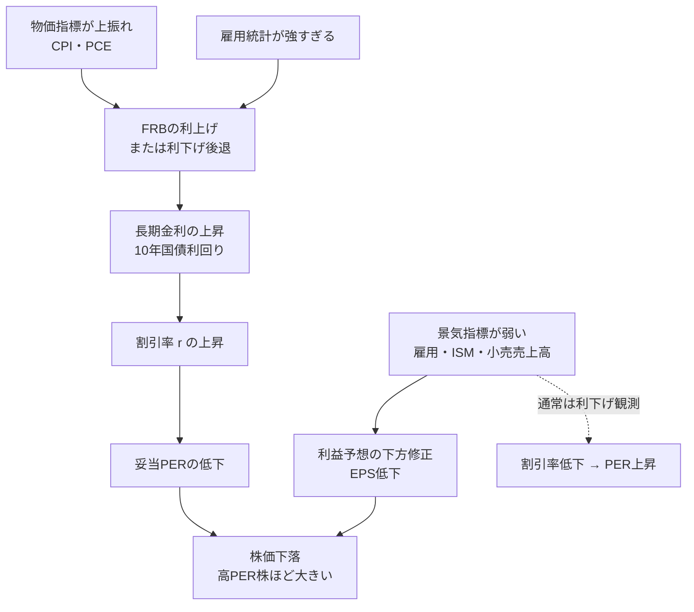

### 14-1 金利・物価・株価の連鎖

株価は「企業の利益（EPS）」と「市場の評価（PER）」で決まり（第3章）、PERは割引率を通じて金利に直結する（第5章3節）。経済指標を読む目的は、この連鎖の次の動きを把握することにある。

2026年秋の米国は、この図の**両方の経路が同時に株価の逆風になる**珍しい局面にある。

- **物価の経路（PER）**：インフレが目標の2%まで下がらず、FRBは2026年9月16日のFOMCで政策金利を0.25ポイント引き上げ、3.75〜4.00%とした（12対0の全会一致）。声明文は「インフレは依然として高い」とし、利上げが目標への「より早い回帰」を支えると説明した。10月14日発表の9月CPIは前年比3.7%と市場予想（3.6%）を上回った。
- **景気の経路（EPS）**：10月2日発表の9月雇用統計は、非農業部門雇用者数が＋2.9万人と市場予想（＋9万人）を大きく下回り、失業率は4.2%に上昇した。7・8月分も合計6万人下方修正された。

通常、景気が弱ければ利下げ観測が生まれ、点線の経路（割引率低下 → PER上昇）が株価を支える。しかし物価が高いままだと、FRBは景気の弱さに対して利下げで応じにくい。**「景気が弱いのに利下げできない」とき、EPSとPERの両方が下押しされる**。10月16日にナスダック総合が1日で▲2.1%と3指数で最も大きく下げ、10年国債利回りが約5.10%に達したのは、この組み合わせの典型的な反応である。

数字の「改定」にも注意する。8月分の雇用者数は9月4日の速報時点では＋16.2万人と予想を大きく上回り、利上げ観測を強める材料になった。ところが10月2日の改定で＋13.3万人に引き下げられた。**市場は発表時点の「予想との差」に反応し、後の改定で解釈を修正する**。速報値1回で結論を出さないことが、指標を読む基本姿勢である。

### 14-2 現在の主要数値（2026年10月16日時点）

{{chart:c23_indicators_now}}

| 指標 | 現在値 | 市場予想・前回 | 時点・出所 | 読み方 |
|---|---:|---|---|---|
| FF金利（政策金利） | 3.75〜4.00% | 前回3.50〜3.75% | 2026年9月16日決定（FRB） | 0.25ポイント利上げ、12対0。議長はケビン・ウォーシュ氏（2026年5月22日就任、パウエル氏の後任） |
| CPI（前年比） | 3.7%（コア2.6%） | 予想3.6%（コア2.5%）、前回3.4% | 2026年9月分、10月14日発表（BLS） | 総合・コアとも予想を上回る。コアの前月比は0.33%で警戒水準（0.3%超） |
| PCE（前年比） | 3.4%（コア3.0%） | 予想3.7%（コア3.3%） | 2026年8月分、9月30日発表（BEA） | 予想を下回ったが、FRBの目標2%を大きく上回ったまま |
| 雇用統計 | ＋2.9万人、失業率4.2% | 予想＋9万人、7・8月分は計6万人下方修正 | 2026年9月分、10月2日発表（BLS） | 雇用は急減速。平均時給は前年比＋3.0% |
| 10年国債利回り | 約5.10% | ― | 2026年10月16日終値 | PERの割引率を押し上げる方向 |
| VIX | 約20.0（19.99） | 前日比＋3.53 | 2026年10月16日終値 | 20前後は警戒域の入口。30超で急落局面（第13章シーンG） |
| ドル円 | 約158円 | 1年前比で約5%の円安 | 2026年10月16日 | 円換算資産額に直結（第1章3節） |

出所：FRB声明（2026年9月16日）、BLS雇用統計（2026年10月2日）、investingLive（9月CPI、2026年10月14日）、Trading Economics（8月PCE、2026年9月30日／ドル円）、Yahoo Finance（10年債・VIX、2026年10月16日）。

### 14-3 主要経済指標カタログ

発表時刻は原則として米東部時間8:30（日本時間 夏21:30／冬22:30）、FOMCの政策金利発表は米東部時間14:00（日本時間 夏3:00／冬4:00）である。2026年は11月1日（日）に米国の夏時間が終わるため、11月以降は冬時間で見る。

| 指標 | 発表元 | 発表頻度・時期 | 何を見るか | 株価との関係 |
|---|---|---|---|---|
| FOMC政策金利・声明・SEP | FRB | 年8回、火水開催、水曜14:00 ET | 政策金利、声明文の変化、SEP（経済見通し）とドットプロット（金利予想） | 利上げ→PER圧縮、利下げ→PER拡大。声明文の一語の変化が数%の変動を生む |
| CPI（消費者物価指数） | 労働統計局（BLS） | 月1回、翌月10〜15日頃 | 総合とコア（食品・エネルギー除く）の前月比・前年比 | 上振れ→利上げ観測→株安。コアの前月比0.3%超は警戒 |
| PCE（個人消費支出物価） | 経済分析局（BEA） | 月1回、翌月末 | FRBが目標2%の基準とする物価指標 | CPIより遅いが、FRBの判断に直結 |
| 雇用統計 | BLS | 月1回、原則翌月第1金曜 | 非農業部門雇用者数（NFP）、失業率、平均時給、過去2か月の改定 | 強すぎ→利上げ懸念、弱すぎ→景気後退懸念。「適温」が最良 |
| GDP | BEA | 四半期（速報・改定・確報） | 実質成長率（年率換算） | 2〜3%が適温。マイナスが2四半期続くと景気後退 |
| ISM製造業・非製造業指数 | ISM | 月1回、月初 | 50が好不況の分岐点 | 50割れの継続→利益予想下方修正 |
| 小売売上高 | 商務省 | 月1回、中旬 | 消費の勢い（米GDPの約7割が個人消費） | 強い→景気堅調、企業の売上予想上振れ |
| 消費者信頼感指数 | コンファレンスボード／ミシガン大 | 月1回 | 消費者心理、期待インフレ率 | 期待インフレ率の上昇はFRBの警戒材料 |
| 10年国債利回り | 市場 | 常時 | 長期金利の代表。住宅ローン・社債金利の基準 | 上昇→高PER株・住宅関連に逆風 |
| VIX | Cboe | 常時 | S&P 500オプションから算出する予想変動率 | 30超→パニック局面、注文方法を切り替える（第13章） |
| 決算シーズン | 各企業 | 1・4・7・10月中旬から約1か月 | S&P 500構成企業のEPS実績とガイダンス | 市場全体のEPS予想の改定方向 |

### 14-4 発表カレンダー（2026年10月〜2027年3月）

{{chart:c22_econ_calendar}}

| FOMC | 日程（決定は最終日14:00 ET） | SEP・ドットプロット |
|---|---|:---:|
| 2026年10月会合 | 10月27〜28日 | ― |
| 2026年12月会合 | 12月8〜9日 | あり |
| 2027年1月会合 | 1月26〜27日 | ― |
| 2027年3月会合 | 3月16〜17日 | あり |
| 2027年4月会合 | 4月27〜28日 | ― |
| 2027年6月会合 | 6月8〜9日 | あり |

FRBの公式カレンダーは、各会合の日程を直前の会合で確定するとしている（暫定扱い）。

| 対象月 | CPI（BLS） | 雇用統計（BLS） | PCE（BEA） |
|---|---|---|---|
| 2026年9月分 | 10月14日（発表済） | 10月2日（発表済） | 10月29日 |
| 2026年10月分 | 11月10日 | 11月6日 | 11月25日 |
| 2026年11月分 | 12月10日 | 12月4日 | 12月23日 |
| 2026年12月分 | 2027年1月13日 | 2027年1月8日 | 要確認（BEAの2027年日程で公表） |
| 2027年1月分 | 2027年2月11日 | 2027年2月5日 | 要確認 |

出所：federalreserve.gov（FOMC日程）、bls.gov（CPI・雇用統計の公表日程）、bea.gov（個人所得・支出の公表日程）。いずれも2026年10月18日時点の掲載内容。

2025年秋には政府機関の一部閉鎖により10月分CPIの公表中止・11月分の延期が起きた。同様の事態が生じると日程は変更されるため、公式サイトで随時確認する。

### 14-5 相場環境の判定と行動の対応

経済指標を個別に追うだけでは判断に結びつかない。金利・物価・景気の3軸で相場環境を判定し、第13章の注文戦略と第15章の配分に接続する。

| 相場環境 | 判定の目安 | 株価への典型的影響 | 注文・配分の対応 |
|---|---|---|---|
| 適温（ゴルディロックス） | 物価2〜3%、失業率4%前後、GDP 2〜3%、VIX 15未満 | 緩やかな上昇、高PER株が優位 | 通常の積立と分割建て（シーンA・B）。追いかけ買いはしない |
| インフレ再燃・利上げ | CPI・PCEが上振れ、10年債利回り上昇、FRBが利上げ | PER圧縮、高PER・高PSR株が下落 | 高PSR株の比率を抑える。バリュー株・FCF利回りの高い株の相対優位 |
| 景気減速・利下げ観測 | ISM 50割れ、雇用鈍化、小売売上高減 | EPS予想の下方修正と、PER拡大が綱引き | 財務健全性（第9章）の高い企業に絞る。ラダーで買い下がる準備 |
| 物価高と景気減速の併存（2026年秋） | 物価が目標を大きく上回る一方、雇用が急減速 | 利下げで支えられず、EPSとPERが同時に下押しされやすい | 積立は継続し、新規の個別株は安全域の基準を厚くする。財務の弱い企業・高PSR株を避ける |
| パニック・急落 | VIX 30超、信用スプレッド拡大 | 全面安、質と無関係に売られる | 成行禁止、ラダー（シーンG）。質の高い企業が安全域付きで買える局面 |
| 過熱 | S&P 500予想PERが歴史的高水準、CAPE高止まり、IPO急増 | 短期は上昇継続、その後の調整幅が大きい | 安全域の基準を厚くする（30%以上）。トレーリングストップで利益確保 |

### 14-6 WSJの活用

The Wall Street Journalは、指標の数字とその市場の解釈を同時に得られる一次情報源である。

| コーナー | 内容 | 活用法 |
|---|---|---|
| What's News（Podcast・紙面） | 朝晩の最重要ニュース | 通勤時に聴き、その日の発表予定と前日の市場反応を把握 |
| Markets面 | 株式・債券・為替の日次動向 | 指標発表翌日に「なぜ動いたか」を確認 |
| Heard on the Street | 個別企業・業界の分析コラム | 第II部の指標を使った論考が多い。自分の分析と照合する |
| Economy面 | FRB・物価・雇用の解説 | FOMC前後の政策議論の把握 |
| 決算関連記事 | 主要企業の決算速報と解説 | 第11章9節の読み方を、記事の解釈と比較する |

指標発表日は、発表前の予想記事、発表直後の速報、翌日の市場反応の解説をセットで読む。この3点を繰り返し追うことで、「どの数字が市場の予想とどれだけ乖離すると、どの資産がどれだけ動くか」という感覚が身につく。

> **投資判断への直結**
> - 最重要の連鎖は「物価上振れ → 利上げ → 割引率上昇 → PER圧縮」。高PER・高PSR株ほど影響が大きい。
> - 2026年10月16日時点はFF金利3.75〜4.00%（9月に利上げ）、CPI 3.7%、コアPCE 3.0%、10年債約5.10%。物価高と雇用減速が併存する局面。
> - 指標は「市場予想との差」で読み、速報値の改定まで追う。CPI・雇用統計・FOMC・PCEの前後30分は注文を出さない。
> - 相場環境を金利・物価・景気の3軸で判定し、注文方法と配分を切り替える。
